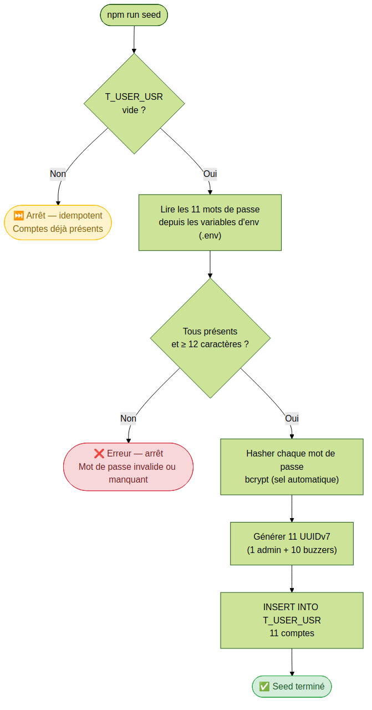
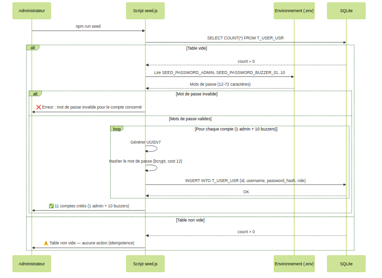

# US-002 — Seed des comptes utilisateurs

## 📋 Contexte projet

Voir [VISION.md](../shared/VISION.md) pour la description complète du projet et de ses quatre applications.

---

## 🎯 User Story

> **En tant qu'** administrateur système,
> **je veux** initialiser les comptes utilisateurs (1 admin + 10 buzzers) via un script de seed,
> **afin de** disposer immédiatement des comptes nécessaires au fonctionnement du quiz.

---

## ✅ Critères d'acceptance

> 🧪 **Exigence de couverture** — Voir [Conventions techniques — Couverture des tests](../shared/CONVENTIONS-TECHNIQUES.md#-exigence-de-couverture-des-tests). Chaque CA doit être couvert par au moins un test automatisé. Couverture globale ≥ 90 %.

### Seed des utilisateurs — `npm run seed`

| # | Critère | Résultat attendu |
|---|---|---|
| CA-1 | Au premier démarrage, si la table `T_USER_USR` est vide, les 11 comptes sont créés automatiquement | 1 admin + 10 buzzers (`quiz_buzzer_01` à `quiz_buzzer_10`) |
| CA-2 | Les mots de passe sont lus depuis des variables d'environnement (fichier `.env` non versionné) | Hashés avec bcrypt avant insertion |
| CA-3 | Le seed est idempotent : si les comptes existent déjà, le script ne fait rien | Pas de doublon ni de réinitialisation |
| CA-4 | Les mots de passe respectent la politique OWASP : 12 caractères minimum | Le seed refuse de s'exécuter si un mot de passe ne respecte pas la politique |

### Sécurité et transversalité

| # | Critère | Résultat attendu |
|---|---|---|
| CA-5 | Tests unitaires et d'intégration | Couverture de tests ≥ 90% |

### Coût bcrypt et message du seed

| # | Critère | Résultat attendu |
|---|---|---|
| CA-6 | `BCRYPT_COST` est renseignée mais n'est pas un entier de 4 à 31 écrit en chiffres seulement (`abc`, `12.5`, `3`, `32`, `-1`, ` 12`) | Le seed refuse de s'exécuter : aucun compte n'est créé, le processus se termine avec le code de sortie `1`, et la console affiche un message qui nomme `BCRYPT_COST` et la règle (entier de 4 à 31). Ex : `User seeding failed: BCRYPT_COST must be an integer between 4 and 31.` Absente ou vide, la variable vaut `12` |
| CA-7 | La table `T_USER_USR` contient déjà au moins un compte | Le seed ne modifie rien (CA-3), affiche une ligne qui dit qu'aucun compte n'a été créé parce que la table n'est pas vide, et se termine avec le code de sortie `0`. Ex : `Seed ignoré — la table T_USER_USR contient déjà des comptes.` |

### Chemin de la base de données

| # | Critère | Résultat attendu |
|---|---|---|
| CA-8 | `SQLITE_DB_PATH` est définie mais vide (chaîne vide), ou faite uniquement de blancs (un ou plusieurs blancs, quels qu'ils soient, et rien d'autre : `" "`, `"   "`, une tabulation, un saut de ligne, un mélange ; liste des blancs plus bas) | Le seed refuse de s'exécuter : aucune base n'est ouverte, aucun fichier n'est créé ni modifié, aucun compte n'est créé, le processus se termine avec le code de sortie `1`, et la sortie d'erreur affiche un message qui nomme `SQLITE_DB_PATH` et la règle (le chemin de la base ne peut être ni vide ni fait uniquement de blancs) sans reprendre la valeur. Ex, non normatif : `User seeding failed: SQLITE_DB_PATH cannot be empty or made only of whitespace.` Absente, la variable vaut `quiz.db`. À la différence de `BCRYPT_COST` (CA-6) et de `JWT_EXPIRATION` (US-003 CA-20), et comme `PORT` (US-001 CA-7) et comme le hub ([US-001](US-001-server-startup.md) CA-10), une chaîne vide est refusée et ne vaut pas absente (décisions #57 et #59) ; une valeur faite uniquement de blancs est refusée de la même façon, même refus et même place dans l'ordre des contrôles que la chaîne vide (décisions #60 et #61, la #61 précisant que les blancs ne se limitent pas à l'espace U+0020). **Règle de lecture** (décision #61, constat reporté) : la valeur est lue sans les blancs qui l'entourent, en tête et en fin ; les blancs à l'intérieur du chemin sont conservés (`qu iz.db` désigne le fichier `qu iz.db`). Si le résultat est vide, c'est-à-dire si la valeur est vide ou faite uniquement de blancs, le refus s'applique ; sinon c'est ce chemin nettoyé qui est utilisé (` quiz.db`, `quiz.db ` et `quiz.db` précédé d'une tabulation et suivi d'un retour chariot et d'un saut de ligne désignent tous `quiz.db`). Refusés : `""`, `" "`, `"   "`, une tabulation seule, un saut de ligne seul, un retour chariot seul, un mélange d'espace, de tabulation et de saut de ligne, une espace insécable seule, U+3000 seul, un BOM seul. Non refusés : une valeur d'un seul U+200B (chemin d'un caractère, le fichier créé a un nom invisible), ou U+200B suivi d'une espace (le blanc de fin est retiré, U+200B reste) : un caractère qui n'est pas un blanc reste dans le chemin. La règle porte sur la valeur telle que le processus la reçoit, qu'elle vienne de l'environnement réel ou d'un `.env` ; la façon dont un `.env` écrit des blancs (guillemets, valeur non quotée) n'est pas spécifiée (sondé, voir `DEBTS.md`). **Blancs** (liste fermée, décision #61) : les 25 caractères suivants et eux seuls : l'espace U+0020, la tabulation U+0009, le saut de ligne (LF) U+000A, la tabulation verticale U+000B, le saut de page U+000C, le retour chariot (CR) U+000D, l'espace insécable U+00A0, l'espace de l'ogham U+1680, les onze espaces typographiques U+2000 à U+200A, le séparateur de ligne U+2028, le séparateur de paragraphe U+2029, l'espace fine insécable U+202F, l'espace moyenne mathématique U+205F, l'espace pleine chasse U+3000 et la marque d'ordre des octets (BOM) U+FEFF. Tout autre caractère n'est pas un blanc, même s'il est invisible : l'espace de largeur nulle U+200B, le caractère de contrôle U+0085 (NEL) et U+180E sont des caractères ordinaires de chemin. Même règle, même liste et mêmes exemples que pour le hub ([US-001](US-001-server-startup.md) CA-10). Ce contrôle passe en premier, avant l'ouverture de la base, donc avant la vérification de la table (CA-7), des mots de passe (CA-4) et de `BCRYPT_COST` (CA-6) : quand `SQLITE_DB_PATH` est vide ou faite uniquement de blancs et qu'un de ces contrôles échouerait aussi, une seule erreur est rapportée, celle de `SQLITE_DB_PATH`, avec le code de sortie `1`, et la ligne du CA-7 n'est pas affichée. Le `SQLITE_DB_PATH=` vide d'un fichier `.env` est refusé comme toute chaîne vide (décisions #52 et #59) |

---

## 🔄 Diagramme de flux



---

## 🔀 Diagramme de séquences



---

## 🔧 Spécifications techniques

Voir les [Conventions techniques](../shared/CONVENTIONS-TECHNIQUES.md) pour la stack complète, les principes d'architecture (KISS, DRY, YAGNI, SOLID) et les conventions de données.

### Dépendance avec US-003

La table `T_USER_USR` est définie dans l'**US-003** (authentification par token). Cette US-002 ne crée pas la table : elle suppose que la base de données a déjà été initialisée (migration exécutée via l'US-003). Le script de seed s'appuie sur le schéma existant.

### Script npm

```json
{
  "scripts": {
    "seed": "node src/seed.js"
  }
}
```

Le script est exécuté en ligne de commande :

```bash
npm run seed
```

### Politique de mot de passe (OWASP)

| Règle | Valeur |
|---|---|
| Longueur minimale | 12 caractères |
| Longueur maximale | 72 caractères (limite bcrypt) |
| Algorithme de hachage | bcrypt (sel automatique) |
| Facteur de coût bcrypt | 12 par défaut (recommandation OWASP), réglable par `BCRYPT_COST` (entier de 4 à 31, CA-6) |

Le script refuse de s'exécuter si un mot de passe lu dans les variables d'environnement ne respecte pas la politique. Le message d'erreur identifie le compte concerné sans exposer le mot de passe.

### Structure des fichiers

```
src/
  seed.js              ← script de seed principal
  seed/__tests__/
    seed.test.js       ← tests unitaires et d'intégration CA-1 à CA-8
```

---

## 🌱 Seed — Description

### Workflow du script

Le script `src/seed.js` suit les étapes suivantes :

```
1. Lecture de SQLITE_DB_PATH, puis connexion à la base de données SQLite
   → SQLITE_DB_PATH définie mais vide, ou faite uniquement de blancs : arrêt avant toute ouverture, code de sortie 1 (CA-8)
   → Blancs en tête et en fin ignorés : le chemin nettoyé est utilisé (CA-8, décision #61)
   → Absente : quiz.db
2. Vérification : la table T_USER_USR est-elle vide ?
   → Non : arrêt immédiat (idempotence — CA-3), avec le message du CA-7 et le code de sortie 0
   → Oui : suite
3. Lecture des 11 mots de passe et de BCRYPT_COST depuis les variables d'environnement
4. Validation de chaque mot de passe (≥ 12 caractères, ≤ 72 caractères), puis de BCRYPT_COST (entier de 4 à 31)
   → Mot de passe invalide ou manquant : arrêt avec message d'erreur (CA-4)
   → BCRYPT_COST invalide : arrêt avec message d'erreur (CA-6)
   → Tout valide : suite
5. Hachage de chaque mot de passe avec bcrypt (facteur de coût : BCRYPT_COST, 12 par défaut)
6. Génération de 11 UUIDv7 (un par compte)
7. Insertion des 11 comptes dans T_USER_USR
8. Affichage du résultat : "Seed terminé — 11 comptes créés."
```

### Comptes créés

| Login | Rôle | Variable d'environnement |
|---|---|---|
| `admin` | `admin` | `SEED_PASSWORD_ADMIN` |
| `quiz_buzzer_01` | `buzzer` | `SEED_PASSWORD_BUZZER_01` |
| `quiz_buzzer_02` | `buzzer` | `SEED_PASSWORD_BUZZER_02` |
| `quiz_buzzer_03` | `buzzer` | `SEED_PASSWORD_BUZZER_03` |
| `quiz_buzzer_04` | `buzzer` | `SEED_PASSWORD_BUZZER_04` |
| `quiz_buzzer_05` | `buzzer` | `SEED_PASSWORD_BUZZER_05` |
| `quiz_buzzer_06` | `buzzer` | `SEED_PASSWORD_BUZZER_06` |
| `quiz_buzzer_07` | `buzzer` | `SEED_PASSWORD_BUZZER_07` |
| `quiz_buzzer_08` | `buzzer` | `SEED_PASSWORD_BUZZER_08` |
| `quiz_buzzer_09` | `buzzer` | `SEED_PASSWORD_BUZZER_09` |
| `quiz_buzzer_10` | `buzzer` | `SEED_PASSWORD_BUZZER_10` |

### Format du fichier `.env`

Les noms des onze variables sont fixés par le [tableau des variables d'environnement](../shared/CONVENTIONS-TECHNIQUES.md#-variables-denvironnement) (décision #39) ; aucune n'a de défaut.

Le fichier `.env` doit être créé à la racine du projet. Il n'est **pas versionné** (ajouté au `.gitignore`).

```dotenv
# Mots de passe du seed — NE PAS VERSIONNER CE FICHIER
SEED_PASSWORD_ADMIN=<mot_de_passe_admin_min_12_car>
SEED_PASSWORD_BUZZER_01=<mot_de_passe_buzzer_01_min_12_car>
SEED_PASSWORD_BUZZER_02=<mot_de_passe_buzzer_02_min_12_car>
SEED_PASSWORD_BUZZER_03=<mot_de_passe_buzzer_03_min_12_car>
SEED_PASSWORD_BUZZER_04=<mot_de_passe_buzzer_04_min_12_car>
SEED_PASSWORD_BUZZER_05=<mot_de_passe_buzzer_05_min_12_car>
SEED_PASSWORD_BUZZER_06=<mot_de_passe_buzzer_06_min_12_car>
SEED_PASSWORD_BUZZER_07=<mot_de_passe_buzzer_07_min_12_car>
SEED_PASSWORD_BUZZER_08=<mot_de_passe_buzzer_08_min_12_car>
SEED_PASSWORD_BUZZER_09=<mot_de_passe_buzzer_09_min_12_car>
SEED_PASSWORD_BUZZER_10=<mot_de_passe_buzzer_10_min_12_car>
```

> ⚠️ **Sécurité** — Ne jamais committer le fichier `.env` dans le dépôt Git. Utiliser `.env.example` (avec des valeurs fictives) comme modèle versionné.

---

## 📐 Périmètre

| Inclus | Exclu |
|---|---|
| Création des 11 comptes (1 admin + 10 buzzers) via script de seed | Création dynamique de comptes via API REST |
| Lecture des mots de passe depuis les variables d'environnement | Interface de gestion des utilisateurs |
| Validation de la politique de mot de passe (OWASP, ≥ 12 caractères) | Modification des comptes après création |
| Hachage bcrypt (facteur de coût : 12 par défaut, réglable par `BCRYPT_COST`) | Suppression des comptes |
| Idempotence (pas de doublon si le seed est rejoué) | Authentification (gérée par US-003) |
| Génération des UUIDv7 | Déploiement / CI-CD |
| Refus de s'exécuter quand `SQLITE_DB_PATH` est définie mais vide, ou faite uniquement de blancs ; blancs de bordure ignorés (CA-8) | |
| Tests unitaires et d'intégration (couverture ≥ 90%) | |

---

## 🔍 Points de vigilance

### Idempotence stricte

Le script vérifie l'état de la table `T_USER_USR` **avant** toute insertion. Si au moins un enregistrement existe, le script s'arrête sans effectuer aucune modification. Cette vérification doit être atomique pour éviter les conditions de course dans un environnement où plusieurs instances démarreraient simultanément.

### Sécurité des mots de passe

Les mots de passe ne doivent **jamais** apparaître dans les logs, les messages d'erreur ou le code source. Le fichier `.env` doit figurer dans `.gitignore`. Le fichier `.env.example` fourni dans le dépôt contient uniquement des valeurs fictives (ex. : `<mot_de_passe_admin_min_12_car>`).

### Limite bcrypt à 72 caractères

bcrypt tronque silencieusement les mots de passe à 72 octets. La validation doit donc imposer une longueur maximale de 72 caractères pour éviter que deux mots de passe distincts (mais partageant les 72 premiers caractères) produisent le même hash.

### Dépendance avec US-003

La table `T_USER_USR` et son schéma sont définis dans l'US-003. Le script de seed doit s'exécuter **après** l'initialisation de la base de données. L'ordre d'exécution recommandé est : `npm run migrate && npm run seed`.

### Facteur de coût bcrypt

Le facteur de coût bcrypt vaut **12** par défaut, conformément aux recommandations OWASP (2024). Ce facteur peut être ajusté via une variable d'environnement `BCRYPT_COST` pour adapter les performances selon l'environnement (ex. : `10` en tests pour accélérer l'exécution). La variable est un entier de 4 à 31 (bornes de bcrypt), écrit en chiffres seulement ; absente ou vide, elle vaut `12` ; renseignée autrement, le seed refuse de s'exécuter (CA-6, décision #42). Seul le seed hache un mot de passe : le hub ne lit pas `BCRYPT_COST`, la comparaison d'un mot de passe lisant le coût dans le hash stocké.

---
