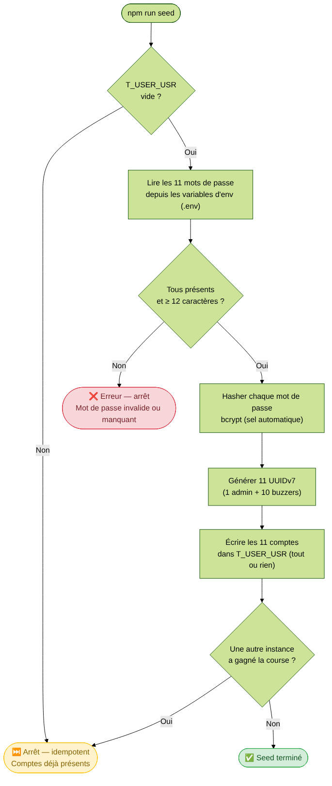
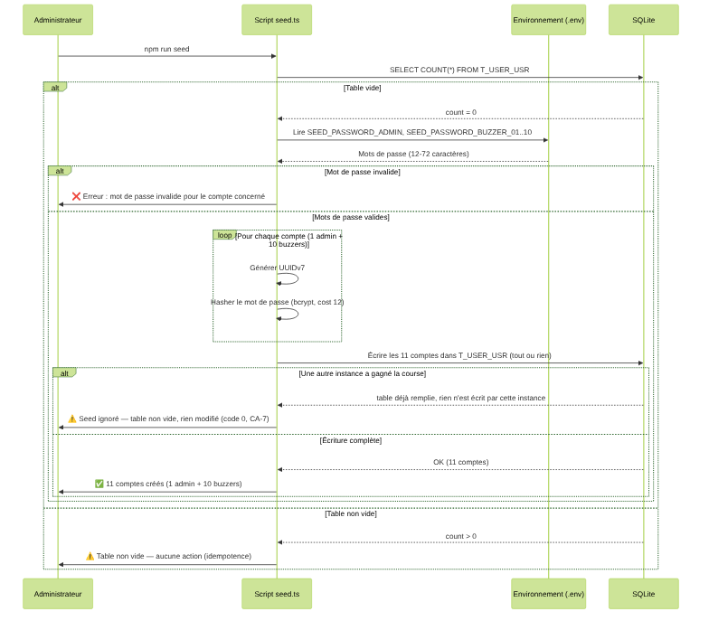

# US-002 — Seed des comptes utilisateurs

## 📋 Contexte projet

Voir [VISION.md](../shared/VISION.md) pour la description complète du projet et de ses quatre applications.

---

## 🎯 User Story

> **En tant qu'** administrateur système,
> **je veux** initialiser les comptes utilisateurs (1 admin + 10 buzzers) via un script de seed,
> **afin de** disposer immédiatement des comptes nécessaires au fonctionnement du quiz.

---

## ✅ Critères d'acceptance

### Seed des utilisateurs — `npm run seed`

| # | Critère | Résultat attendu |
|---|---|---|
| CA-1 | Au premier démarrage, si la table `T_USER_USR` est vide, les 11 comptes sont créés automatiquement | 1 admin + 10 buzzers (`quiz_buzzer_01` à `quiz_buzzer_10`). Le seed se termine avec le code de sortie `0` et affiche une ligne de succès sur la sortie standard ; la sortie d'erreur reste vide (décision #73). Normatif : la ligne dit que les onze comptes ont été créés. Ex, non normatif : `Seed terminé — 11 comptes créés.` |
| CA-2 | Les mots de passe sont lus depuis des variables d'environnement (fichier `.env` non versionné) | Hashés avec bcrypt avant insertion |
| CA-3 | Le seed est idempotent : si les comptes existent déjà, le script ne fait rien | Pas de doublon ni de réinitialisation. **Tout ou rien** (décision #77) : quel que soit le moment où le processus du seed s'arrête, arrêt brutal compris (signal `SIGKILL`, coupure), la table `T_USER_USR` contient ensuite les onze comptes ou aucun, jamais une partie ; un arrêt après l'écriture des onze comptes peut seulement faire manquer la ligne de succès du CA-1, et le lancement suivant affiche alors la ligne du CA-7. Un lancement qui suit un arrêt qui n'a rien laissé trouve la table vide et crée les onze comptes (CA-1). La garantie vaut aussi quand deux seeds s'exécutent en même temps (CA-7). Le CDC dit la garantie, pas le mécanisme (décision #77). **Table après un arrêt qui n'a rien laissé** (décision #79, constat reporté, pas une règle) : « aucun compte » ne dit rien de l'existence de la table `T_USER_USR`, et le CDC n'impose ni qu'elle existe ni qu'elle soit absente. Sondé le 2026-11-21 (Linux, Node 22, root, `tsx src/seed.ts`, une seule machine) : un arrêt brutal avant la création de la table laisse un fichier de base sans table ; un arrêt après sa création, y compris juste après le premier `INSERT` de l'écriture, laisse la table vide, sans compte. Dans les deux cas le lancement suivant crée la table si elle manque (CA-9) puis les onze comptes (CA-1) |
| CA-4 | Les mots de passe respectent la politique OWASP : de 12 à 72 caractères, tous de l'ASCII imprimable (U+0020 à U+007E), et pas uniquement des espaces (U+0020) ; 72 caractères valent 72 octets, la limite de bcrypt (décision #74) | Le seed refuse de s'exécuter si un mot de passe manque (variable non définie) ou ne respecte pas la politique (trop court, trop long, un caractère hors de l'ASCII imprimable, tabulation ou saut de ligne compris, variable définie mais vide, ou faite uniquement d'espaces) : aucun compte n'est créé, le processus se termine avec le code de sortie `1`, la sortie standard est vide, et la sortie d'erreur affiche un message qui commence par `User seeding failed: `, nomme un seul compte (celui dont le mot de passe est refusé) et ne reprend pas le mot de passe. Seuls sont normatifs ce préfixe, le nom du compte et l'absence du mot de passe ; les libellés sont des exemples, non normatifs, comme les lignes du CA-7 et du CA-1 : `User seeding failed: Missing password for account <login>` (variable non définie) et `User seeding failed: Invalid password for account <login>` (tout autre refus, variable définie mais vide comprise). La base que l'ouverture a créée n'est pas supprimée (CA-9, décision #65) |

> **Note du 2026-11-21 (décision #54)** — CA-5 (« Tests unitaires et d'intégration — Couverture de tests ≥ 90% ») est retiré, comme CA-6 d'US-001 le 2026-11-14 : la couverture relève de la méthode TDD, pas d'un critère d'acceptance (le seuil global de 90 % est appliqué par la CI, décision #67 ; la règle « un CA = au moins un test » est inchangée). Le bandeau « Exigence de couverture » est retiré avec lui. La numérotation des autres CA est conservée (CA-6 est cité par les décisions, par les tests et par les handoffs) : il n'y a donc pas de CA-5.

### Coût bcrypt et message du seed

| # | Critère | Résultat attendu |
|---|---|---|
| CA-6 | `BCRYPT_COST` est renseignée mais n'est pas un entier de 4 à 31 écrit en chiffres ASCII seulement, sans zéro en tête. Refusés : `abc`, `12.5`, `3`, `32`, `-1`, ` 12`, `0`, `4.0`, `+5`, `004`, un chiffre d'une autre écriture (par exemple arabo-indien : `٤`), un entier hors de la plage de lecture (par exemple vingt chiffres), et une valeur faite uniquement de blancs (` `, une tabulation : seule la chaîne vide vaut absente) (décision #74) | Le seed refuse de s'exécuter : aucun compte n'est créé, le processus se termine avec le code de sortie `1`, la sortie standard est vide, et la sortie d'erreur affiche un message qui commence par `User seeding failed: `, nomme `BCRYPT_COST` et la règle (entier de 4 à 31), comme les refus des CA-8 et CA-9. Ex, non normatif : `User seeding failed: BCRYPT_COST must be an integer between 4 and 31.` Absente ou vide (chaîne vide), la variable vaut `12`. À la différence de `PORT` ([US-001](US-001-server-startup.md) CA-7), qui accepte les zéros en tête (`08080` vaut 8080), `004` est refusée (choix d'Olivier, décision #74). La base que l'ouverture a créée n'est pas supprimée (CA-9, décision #65) |
| CA-7 | La table `T_USER_USR` contient déjà au moins un compte, que ce soit au moment du contrôle de l'étape 2 ou parce qu'une autre instance du seed l'a remplie entre ce contrôle et l'écriture de celle-ci (**course**, décision #77) | Le seed ne modifie rien (CA-3) et se termine avec le code de sortie `0`. Il affiche une ligne sur la sortie standard ; la sortie d'erreur reste vide (décision #66). Normatif : la ligne dit qu'aucun compte n'a été créé parce que la table n'est pas vide. Ex, non normatif : `Seed ignoré — la table T_USER_USR contient déjà des comptes.` (décisions #53 et #66). **Course** (décision #77) : quand deux instances du seed s'exécutent en même temps sur une table vide, une seule crée les onze comptes (code de sortie `0`, ligne de succès du CA-1) ; l'autre, la perdante, se comporte comme un seed lancé sur une table non vide : elle ne modifie rien, affiche sur la sortie standard la ligne du CA-7 (mêmes règles de flux ; **même sens, pas forcément même texte** : seul le sens est normatif, comme pour un seed lancé sur une table non vide, décisions #66 et #79 ; le texte de la perdante n'a donc pas à être égal à celui d'un second lancement, ni à celui du gagnant), se termine avec le code de sortie `0`, la sortie d'erreur vide, et ne laisse aucun compte à elle. Il n'y a pas de cas où la perdante sort avec le code `1` ou affiche une contrainte d'unicité, quel que soit le moment où elle s'aperçoit qu'elle a perdu, avant ou pendant son écriture. La base contient alors les onze comptes du gagnant, tous issus du même lancement (mêmes mots de passe). **Ordre des contrôles inchangé** : une instance qui voit la table vide à l'étape 2 et dont un mot de passe ou `BCRYPT_COST` est invalide se refuse avant toute écriture (CA-4 et CA-6, code `1`) ; la course ne se joue qu'à l'écriture. **Base laissée par une version antérieure** (constat reporté, pas une règle) : le CA-7 parle d'au moins un compte ; une base qui porte une partie des comptes, laissée par un arrêt brutal d'un seed antérieur à la décision #77 (sondé : de 1 à 10 comptes `quiz_buzzer_*`, jamais l'admin), est ignorée comme toute table non vide, et ses comptes manquants ne sont pas créés par le seed ; une fois la garantie du CA-3 tenue, une table non vide porte les onze comptes. **Verrou d'écriture tenu par un autre processus** (décision #80, constat reporté, pas une règle ; sondé le 2026-11-21, Linux, Node 22, root, `BCRYPT_COST=4`, `tsx src/seed.ts`, une seule machine, base sur disque local) : le CDC n'impose pas ce que rend le seed quand son écriture n'obtient pas le verrou d'écriture de la base dans le délai de celle-ci (5 s par défaut avec `better-sqlite3`). Constaté sur une table `T_USER_USR` existante et vide, dont un autre processus tient le verrou d'écriture (`BEGIN IMMEDIATE`) pendant 10 s : le seed attend, puis se termine avec le code de sortie `1`, la sortie standard vide et la sortie d'erreur `User seeding failed: database is locked` ; aucun compte n'est écrit, la table reste vide. Durée mesurée, démarrage de `tsx` compris (environ 0,5 s sans verrou) : 5,59 s et 5,61 s sur deux essais, 7,9 s sur un premier essai à froid, 5,53 s avec un verrou tenu 9 s. Ce n'est pas la course ci-dessus : celui qui tient le verrou n'est pas un seed gagnant, il n'y a donc pas de perdante, et la sortie en code `0` de la perdante ne s'y applique pas. Constaté aussi : quand l'autre processus relâche le verrou avant la fin du délai (sondé : verrou tenu 3 s), le seed réussit comme d'ordinaire : code de sortie `0`, ligne de succès du CA-1, sortie d'erreur vide, onze comptes. Le texte exact, la durée de l'attente et la cause sont ceux du système et de la base et ne sont pas imposés ; seul le préfixe `User seeding failed: ` suit la convention des autres refus (CA-4, CA-6, CA-8 et CA-9) |

### Chemin de la base de données

| # | Critère | Résultat attendu |
|---|---|---|
| CA-8 | `SQLITE_DB_PATH` est définie mais vide (chaîne vide), ou faite uniquement de blancs (un ou plusieurs blancs, quels qu'ils soient, et rien d'autre : `" "`, `"   "`, une tabulation, un saut de ligne, un mélange ; liste des blancs plus bas) | Le seed refuse de s'exécuter : aucune base n'est ouverte, aucun fichier n'est créé ni modifié, aucun compte n'est créé, le processus se termine avec le code de sortie `1`, et la sortie d'erreur affiche un message qui nomme `SQLITE_DB_PATH` et la règle (le chemin de la base ne peut être ni vide ni fait uniquement de blancs) sans reprendre la valeur. Ex, non normatif : `User seeding failed: SQLITE_DB_PATH cannot be empty or made only of whitespace.` Absente, la variable vaut `quiz.db`. À la différence de `BCRYPT_COST` (CA-6) et de `JWT_EXPIRATION` (US-003 CA-20), et comme `PORT` (US-001 CA-7) et comme le hub ([US-001](US-001-server-startup.md) CA-10), une chaîne vide est refusée et ne vaut pas absente (décisions #57 et #59) ; une valeur faite uniquement de blancs est refusée de la même façon, même refus et même place dans l'ordre des contrôles que la chaîne vide (décisions #60 et #61, la #61 précisant que les blancs ne se limitent pas à l'espace U+0020). **Règle de lecture** (décision #61, constat reporté) : la valeur est lue sans les blancs qui l'entourent, en tête et en fin ; les blancs à l'intérieur du chemin sont conservés (`qu iz.db` désigne le fichier `qu iz.db`). Si le résultat est vide, c'est-à-dire si la valeur est vide ou faite uniquement de blancs, le refus s'applique ; sinon c'est ce chemin nettoyé qui est utilisé (` quiz.db`, `quiz.db ` et `quiz.db` précédé d'une tabulation et suivi d'un retour chariot et d'un saut de ligne désignent tous `quiz.db`). Refusés : `""`, `" "`, `"   "`, une tabulation seule, un saut de ligne seul, un retour chariot seul, un mélange d'espace, de tabulation et de saut de ligne, une espace insécable seule, U+3000 seul, un BOM seul. Non refusés : une valeur d'un seul U+200B (chemin d'un caractère, le fichier créé a un nom invisible), ou U+200B suivi d'une espace (le blanc de fin est retiré, U+200B reste) : un caractère qui n'est pas un blanc reste dans le chemin. **Valeur `:memory:`** (décision #63, constat reporté) : `:memory:` est une valeur non vide et qui n'est pas faite de blancs, donc elle n'est pas refusée par ce critère, et le seed n'est pas refusé non plus. Le seed réussit : code de sortie `0`, la ligne de succès du CA-1 sur la sortie standard et la sortie d'erreur vide, aucun fichier n'est créé, et les onze comptes sont écrits dans une base en mémoire qui disparaît avec le processus, donc aucun compte ne survit. La règle de lecture ci-dessus s'applique avant : ` :memory: ` (blancs de bordure retirés) désigne `:memory:`, même résultat. **Origine de la valeur** (décision #71, constat reporté). La règle porte sur la valeur telle que le processus la reçoit, qu'elle vienne de l'environnement réel ou d'un `.env` ; le `.env` est lu par la bibliothèque `dotenv`, comme pour le hub, avec les mêmes constats d'écriture (valeur non quotée rognée, valeur entre guillemets conservée puis soumise à la règle de lecture, ` #` non quoté qui coupe la valeur, `:memory:` acceptée) : voir [US-001](US-001-server-startup.md) CA-10, « Origine de la valeur ». Constaté sur le hub le 2026-11-19 ; le seed charge `dotenv` de la même façon (`import 'dotenv/config'`) et lit la valeur par la même fonction, et les mêmes écritures sont prouvées sur le processus réel du seed (`src/seed.test.ts`), sans écart constaté avec le hub : blancs seuls non quotés lus vides donc refusés, blancs seuls entre `"`, `'` et accents graves refusés, blancs intérieurs conservés, ` #` non quoté qui coupe la valeur, blancs de bordure retirés, `:memory:` acceptée. **Blancs** (liste fermée, décision #61) : les 25 caractères suivants et eux seuls : l'espace U+0020, la tabulation U+0009, le saut de ligne (LF) U+000A, la tabulation verticale U+000B, le saut de page U+000C, le retour chariot (CR) U+000D, l'espace insécable U+00A0, l'espace de l'ogham U+1680, les onze espaces typographiques U+2000 à U+200A, le séparateur de ligne U+2028, le séparateur de paragraphe U+2029, l'espace fine insécable U+202F, l'espace moyenne mathématique U+205F, l'espace pleine chasse U+3000 et la marque d'ordre des octets (BOM) U+FEFF. Tout autre caractère n'est pas un blanc, même s'il est invisible : l'espace de largeur nulle U+200B, le caractère de contrôle U+0085 (NEL) et U+180E sont des caractères ordinaires de chemin. Même règle, même liste et mêmes exemples que pour le hub ([US-001](US-001-server-startup.md) CA-10). Ce contrôle passe en premier, avant l'ouverture de la base (CA-9), donc avant la vérification de la table (CA-7), des mots de passe (CA-4) et de `BCRYPT_COST` (CA-6) : quand `SQLITE_DB_PATH` est vide ou faite uniquement de blancs et qu'un de ces contrôles échouerait aussi, une seule erreur est rapportée, celle de `SQLITE_DB_PATH`, avec le code de sortie `1`, et la ligne du CA-7 n'est pas affichée. Le `SQLITE_DB_PATH=` vide d'un fichier `.env` est refusé comme toute chaîne vide (décisions #52 et #59) |
| CA-9 | La base de données ne peut pas être ouverte, ou le fichier désigné n'est pas une base SQLite (le chemin `SQLITE_DB_PATH`, `quiz.db` par défaut, désigne par exemple un dossier qui n'existe pas, un dossier, ou un fichier existant qui n'est pas une base SQLite, comme un fichier texte) | Le seed refuse de s'exécuter : aucun compte n'est créé, le processus se termine avec le code de sortie `1`, et la sortie d'erreur affiche `User seeding failed: <cause>`, avec le même préfixe que les autres refus du seed (CA-4, CA-6 et CA-8). La cause est celle que donne le système. Ex, non normatif : `User seeding failed: Cannot open database because the directory does not exist` ; pour un chemin qui désigne un dossier : `User seeding failed: unable to open database file` ; pour un fichier qui n'est pas une base SQLite : `User seeding failed: file is not a database` (décisions #53, #59 et #62). L'erreur d'un fichier qui n'est pas une base SQLite peut survenir après l'ouverture du fichier, à la première instruction adressée à la base (par exemple celle qui crée la table `T_USER_USR` quand le repository est instancié) : elle compte, et le refus vaut, tant qu'elle précède la vérification de la table (CA-7) (décision #62, comme pour le hub, [US-001](US-001-server-startup.md) CA-9, décisions #55 et #56). **Place dans l'ordre des contrôles** (décision #62, constat reporté) : après le contrôle de `SQLITE_DB_PATH` (CA-8), qui reste le premier, et avant la vérification de la table (CA-7), des mots de passe (CA-4) et de `BCRYPT_COST` (CA-6) ; quand la base ne peut pas être ouverte et qu'un de ces contrôles échouerait aussi, une seule erreur est rapportée, celle de la base, avec le code de sortie `1`, et la ligne du CA-7 n'est pas affichée ; quand `SQLITE_DB_PATH` est aussi vide ou faite uniquement de blancs, c'est celle du CA-8. **Fichier absent et fichier de zéro octet** (décision #64, constat reporté) : à l'inverse, un fichier de base absent dans un dossier qui existe n'est pas une erreur : le fichier est créé automatiquement au chemin `SQLITE_DB_PATH` et le seed se déroule normalement (les onze comptes sont créés, code de sortie `0`, la ligne de succès du CA-1 sur la sortie standard et la sortie d'erreur vide ; un second lancement affiche la ligne du CA-7, code de sortie `0`), comme pour le hub ([US-001](US-001-server-startup.md) CA-9, décision #56). De même, un fichier de base existant de zéro octet (fichier vide) n'est pas une erreur : il est traité comme une base neuve et le seed se déroule normalement (les onze comptes sont créés, code de sortie `0`, la ligne de succès du CA-1 sur la sortie standard et la sortie d'erreur vide), comme pour le hub (décision #58) ; il ne relève donc pas du refus « fichier qui n'est pas une base SQLite » ci-dessus (décisions #62 et #64). L'ordre des contrôles ci-dessus ne change pas. **Base laissée par un refus ultérieur** (décision #65, constat reporté) : l'ouverture précède les contrôles des mots de passe (CA-4) et de `BCRYPT_COST` (CA-6) ; quand l'un d'eux refuse, le fichier de base n'est pas supprimé et ce que l'ouverture a fait reste : un fichier absent dans un dossier qui existe a été créé, avec la table `T_USER_USR` vide et zéro compte ; un fichier existant de zéro octet a reçu cette table, zéro compte ; une base qui existe déjà n'est pas touchée. Le lancement suivant, une fois la cause corrigée, trouve la table vide : le CA-1 s'applique et crée les onze comptes. Le hub fait de même quand son écoute échoue ([US-001](US-001-server-startup.md) CA-8, décision #65). **Base en lecture seule** (décision #72, constat reporté, pas une règle ; sondé le 2026-11-19, Linux, compte non-root, `tsx src/seed.ts` comme `npm run seed`, une seule machine ; Windows n'est pas sondé pour le seed, et en root les permissions sont ignorées : le seed écrit). Quand la table `T_USER_USR` contient déjà des comptes, le seed n'écrit rien et la lecture seule ne change rien : base en lecture seule, ou inscriptible dans un dossier en lecture seule, le seed affiche la ligne du CA-7 sur la sortie standard et se termine avec le code de sortie `0`, la sortie d'erreur vide, la base intacte ; le CA-7 passe avant le CA-4 et le CA-6, donc un mot de passe invalide ou un `BCRYPT_COST` invalide n'y change rien. Quand la table est vide, ou à créer (fichier de zéro octet), le seed devrait écrire et ne le peut pas : il se termine avec le code de sortie `1`, la sortie d'erreur affiche `User seeding failed: <cause>` (même préfixe que les autres refus), la sortie standard est vide, aucun compte n'est créé et la base est laissée intacte. Constaté pour une base en lecture seule qui a `T_USER_USR` sans compte (ou les trois tables), pour un fichier de zéro octet en lecture seule, et pour une base inscriptible dans un dossier en lecture seule ; la cause constatée est `attempt to write a readonly database`, et `unable to open database file` pour un fichier absent dans un dossier en lecture seule (rien n'est créé) ; le texte exact est celui que donne le système, comme ci-dessus, et n'est pas imposé. Place dans l'ordre des contrôles : quand `T_USER_USR` existe, l'échec est celui de la première insertion, après le contrôle des mots de passe et de `BCRYPT_COST` (un mot de passe invalide est rapporté, pas la lecture seule) ; quand `T_USER_USR` doit être créée (fichier de zéro octet ; une base qui a d'autres tables mais pas celle-ci n'est pas sondée), c'est la première instruction adressée à la base qui échoue, avant la vérification de la table (CA-7), comme ci-dessus. Les phrases qui précèdent sur le fichier absent et le fichier de zéro octet (« le seed se déroule normalement ») valent quand on peut écrire dans le fichier ou dans le dossier. Pour le seed, seule compte la présence de `T_USER_USR` ; le hub, lui, démarre sur une base en lecture seule qui a les trois tables et dont les écritures échouent ensuite ([US-001](US-001-server-startup.md) CA-9, décision #69) |

### Variable que le seed ignore

| # | Critère | Résultat attendu |
|---|---|---|
| CA-10 | `MAX_REQUESTS_PER_MINUTE` a une valeur quelconque dans l'environnement réel ou dans le `.env` : absente, valide, chaîne vide, blancs seuls, `abc`, `0`, `2147483648`, ou toute autre (décision #95) | Le seed ignore la variable : elle n'a aucun effet sur lui. Il réussit ou échoue exactement comme si elle n'existait pas, avec les mêmes sorties (standard et d'erreur), le même code de sortie et les mêmes comptes créés ou non ; un refus d'une autre cause (CA-4, CA-6, CA-8, CA-9) garde son message et son code. Jamais de message qui nomme `MAX_REQUESTS_PER_MINUTE`. Même principe que `JWT_SECRET` et `JWT_EXPIRATION` ([US-003](US-003-authentication-token.md) CA-19) ; le refus d'une valeur invalide est celui du hub seulement ([US-003](US-003-authentication-token.md) CA-21, décision #94) |

---

## 🔄 Diagramme de flux



---

## 🔀 Diagramme de séquences



---

## 🔧 Spécifications techniques

Voir les [Conventions techniques](../shared/CONVENTIONS-TECHNIQUES.md) pour la stack complète, les principes d'architecture (KISS, DRY, YAGNI, SOLID) et les conventions de données.

### Dépendance avec US-003

La définition du schéma de la table `T_USER_USR` (colonnes, contraintes) appartient à l'**US-003** (authentification par token). Le seed crée la table si elle manque : un fichier de base absent dans un dossier qui existe, ou existant de zéro octet, n'est pas une erreur et le seed réussit (CA-9, décisions #64, #72 et #74). Aucune étape de migration ne le précède : il n'existe pas de script `migrate`.

### Script npm

```json
{
  "scripts": {
    "seed": "tsx src/seed.ts"
  }
}
```

Le script est exécuté en ligne de commande :

```bash
npm run seed
```

### Politique de mot de passe (OWASP)

| Règle | Valeur |
|---|---|
| Longueur minimale | 12 caractères |
| Longueur maximale | 72 caractères (limite bcrypt : 72 caractères ASCII valent 72 octets) |
| Caractères admis | L'ASCII imprimable seulement, de U+0020 à U+007E (l'espace est admise) ; tabulation, saut de ligne et tout caractère hors de cette plage sont refusés |
| Mot de passe de blancs seuls | Refusé : un mot de passe fait uniquement d'espaces (U+0020) est invalide, même s'il compte au moins 12 caractères (décision #74) |
| Algorithme de hachage | bcrypt (sel automatique) |
| Facteur de coût bcrypt | 12 par défaut (recommandation OWASP), réglable par `BCRYPT_COST` (entier de 4 à 31, CA-6) |

Le script refuse de s'exécuter si un mot de passe lu dans les variables d'environnement manque ou ne respecte pas la politique (CA-4, décision #74). Le message d'erreur, écrit sur la sortie d'erreur avec le préfixe `User seeding failed: `, identifie un seul compte, celui dont le mot de passe est refusé, sans exposer le mot de passe.

### Structure des fichiers

```
src/
  seed.ts              ← script de seed principal (lancé par `tsx`)
  seed.test.ts         ← tests sur le processus réel (`tsx src/seed.ts`)
  users/
    seed-users.ts      ← règle du seed (table vide, mots de passe, comptes)
    seed-users.test.ts ← tests du service
```

---

## 🌱 Seed — Description

### Workflow du script

Le script `src/seed.ts` suit les étapes suivantes :

```
1. Lecture de SQLITE_DB_PATH, puis connexion à la base de données SQLite
   → SQLITE_DB_PATH définie mais vide, ou faite uniquement de blancs : arrêt avant toute ouverture, code de sortie 1 (CA-8)
   → Blancs en tête et en fin ignorés : le chemin nettoyé est utilisé (CA-8, décision #61)
   → `:memory:` : base en mémoire, le seed réussit (code de sortie 0), aucun fichier créé, aucun compte ne survit au processus (CA-8, décision #63)
   → Base qui ne peut pas être ouverte, ou fichier qui n'est pas une base SQLite : arrêt avec `User seeding failed: <cause>`, code de sortie 1, aucun compte créé (CA-9, décision #62) ; l'erreur peut survenir à la première instruction adressée à la base, avant l'étape 2
   → Fichier absent dans un dossier qui existe : créé au chemin, le seed se déroule normalement ; fichier existant de zéro octet : traité comme une base neuve, le seed se déroule normalement ; ni l'un ni l'autre n'est un refus (CA-9, décision #64)
   → Absente : quiz.db
   → Base en lecture seule (ou dossier en lecture seule) : constat reporté, l'échec n'a lieu qu'à la première écriture, donc à l'étape 1 seulement si `T_USER_USR` doit être créée (arrêt avec `User seeding failed: <cause>`, code de sortie 1, aucun compte créé), sinon à l'étape 7 (CA-9, décision #72)
2. Vérification : la table T_USER_USR est-elle vide ?
   → Non : arrêt immédiat (idempotence — CA-3), avec la ligne du CA-7 sur la sortie standard et le code de sortie 0 (décision #66) ; même issue sur une base en lecture seule, rien n'étant écrit (CA-9, décision #72)
   → Oui : suite (une autre instance peut encore la remplir avant l'étape 7 : voir l'étape 7)
3. Lecture des 11 mots de passe et de BCRYPT_COST depuis les variables d'environnement
   → `MAX_REQUESTS_PER_MINUTE` n'est lue à aucune étape : quelle que soit sa valeur, elle ne change rien au déroulement ni aux sorties (CA-10, décision #95)
4. Validation de chaque mot de passe (de 12 à 72 caractères, ASCII imprimable U+0020 à U+007E, pas uniquement des espaces), puis de BCRYPT_COST (entier de 4 à 31 en chiffres ASCII, sans zéro en tête ; chaîne vide ou absente : 12)
   → Mot de passe invalide ou manquant : arrêt avec `User seeding failed: <message>` sur la sortie d'erreur, qui nomme le compte sans le mot de passe, sortie standard vide, code de sortie 1 (CA-4, décision #74)
   → BCRYPT_COST invalide : arrêt avec `User seeding failed: <message>` sur la sortie d'erreur, qui nomme BCRYPT_COST et la règle, sortie standard vide, code de sortie 1 (CA-6, décision #74)
   → Tout valide : suite
5. Hachage de chaque mot de passe avec bcrypt (facteur de coût : BCRYPT_COST, 12 par défaut)
6. Génération de 11 UUIDv7 (un par compte)
7. Écriture des 11 comptes dans T_USER_USR : tout ou rien, jamais une partie, quel que soit le moment d'un arrêt (CA-3, décision #77)
   → Une autre instance a rempli la table avant cette écriture (course perdue) : rien n'est modifié, la ligne du CA-7 sur la sortie standard, sortie d'erreur vide, code de sortie 0 (CA-7, décision #77)
   → Le verrou d'écriture est tenu par un autre processus au-delà du délai de la base : constat reporté, pas une règle ; sondé : code de sortie 1, sortie standard vide, `User seeding failed: database is locked`, aucun compte écrit ; verrou relâché avant la fin du délai : le seed réussit (CA-7, décision #80)
   → Tout est écrit : suite
8. Affichage du résultat : une ligne de succès sur la sortie standard, la sortie d'erreur restant vide, code de sortie 0 (CA-1, décision #73 ; ex, non normatif : "Seed terminé — 11 comptes créés.")
```

### Comptes créés

| Login | Rôle | Variable d'environnement |
|---|---|---|
| `admin` | `admin` | `SEED_PASSWORD_ADMIN` |
| `quiz_buzzer_01` | `buzzer` | `SEED_PASSWORD_BUZZER_01` |
| `quiz_buzzer_02` | `buzzer` | `SEED_PASSWORD_BUZZER_02` |
| `quiz_buzzer_03` | `buzzer` | `SEED_PASSWORD_BUZZER_03` |
| `quiz_buzzer_04` | `buzzer` | `SEED_PASSWORD_BUZZER_04` |
| `quiz_buzzer_05` | `buzzer` | `SEED_PASSWORD_BUZZER_05` |
| `quiz_buzzer_06` | `buzzer` | `SEED_PASSWORD_BUZZER_06` |
| `quiz_buzzer_07` | `buzzer` | `SEED_PASSWORD_BUZZER_07` |
| `quiz_buzzer_08` | `buzzer` | `SEED_PASSWORD_BUZZER_08` |
| `quiz_buzzer_09` | `buzzer` | `SEED_PASSWORD_BUZZER_09` |
| `quiz_buzzer_10` | `buzzer` | `SEED_PASSWORD_BUZZER_10` |

### Format du fichier `.env`

Les noms des onze variables sont fixés par le [tableau des variables d'environnement](../shared/CONVENTIONS-TECHNIQUES.md#-variables-denvironnement) (décision #39) ; aucune n'a de défaut.

Le fichier `.env` doit être créé à la racine du projet. Il n'est **pas versionné** (ajouté au `.gitignore`).

```dotenv
# Modèle du .env : copier en .env (non versionné), puis remplacer chaque valeur
SEED_PASSWORD_ADMIN=<a_changer>
SEED_PASSWORD_BUZZER_01=<a_changer>
SEED_PASSWORD_BUZZER_02=<a_changer>
SEED_PASSWORD_BUZZER_03=<a_changer>
SEED_PASSWORD_BUZZER_04=<a_changer>
SEED_PASSWORD_BUZZER_05=<a_changer>
SEED_PASSWORD_BUZZER_06=<a_changer>
SEED_PASSWORD_BUZZER_07=<a_changer>
SEED_PASSWORD_BUZZER_08=<a_changer>
SEED_PASSWORD_BUZZER_09=<a_changer>
SEED_PASSWORD_BUZZER_10=<a_changer>
```

> **Placeholder `<a_changer>`** (décision #75, choix de rédaction du modèle, pas une règle de comportement) — `<a_changer>` compte 11 caractères, un de moins que le minimum de 12 du CA-4 : un `.env` copié de ce modèle sans être édité est refusé par le seed au titre du CA-4 (code de sortie `1`, sortie standard vide, sortie d'erreur `User seeding failed: ` suivie d'un message qui nomme un seul compte, aucun compte créé), au lieu de créer onze comptes à mots de passe publics. Le seed ne change pas : il ne connaît pas ce placeholder et n'applique que le CA-4. Un placeholder « de la bonne longueur » (par exemple `<mot_de_passe_admin_min_12_car>`, 31 caractères) passerait le CA-4 et serait accepté. **Lien avec le CA-4** : si le minimum du CA-4 change un jour, le placeholder doit changer avec lui, et rester plus court que le nouveau minimum.

> **Modèle partagé avec le hub** (décision #76, choix de rédaction du modèle, pas une règle de comportement) — `.env.example` n'est pas seulement le modèle du seed : le bloc ci-dessus n'en montre que les lignes du seed. Le modèle porte aussi, pour le hub, `JWT_SECRET` **sans valeur** (une copie non éditée est refusée par le hub au démarrage, [US-001](US-001-server-startup.md) CA-1 et [US-003](US-003-authentication-token.md) CA-19) et `JWT_EXPIRATION` en ligne commentée (US-003, CA-20) ; leur contenu est écrit dans US-003, section « Fichier `.env` et sécurité ». Les autres variables du hub ne sont pas traitées par cette décision.

> ⚠️ **Sécurité** — Ne jamais committer le fichier `.env` dans le dépôt Git. Utiliser `.env.example` comme modèle versionné (valeurs fictives pour les mots de passe du seed ; `JWT_SECRET` sans valeur, décision #76).

---

## 📐 Périmètre

| Inclus | Exclu |
|---|---|
| Création des 11 comptes (1 admin + 10 buzzers) via script de seed | Création dynamique de comptes via API REST |
| Lecture des mots de passe depuis les variables d'environnement | Interface de gestion des utilisateurs |
| Validation de la politique de mot de passe (OWASP : de 12 à 72 caractères ASCII imprimables, pas uniquement des espaces ; CA-4, décision #74) | Modification des comptes après création |
| Hachage bcrypt (facteur de coût : 12 par défaut, réglable par `BCRYPT_COST` : entier de 4 à 31 en chiffres ASCII, sans zéro en tête ; CA-6, décision #74) | Suppression des comptes |
| Idempotence (pas de doublon si le seed est rejoué) | Authentification (gérée par US-003) |
| Tout ou rien : onze comptes ou aucun, arrêt brutal compris ; jamais de compte partiel (CA-3, décision #77) | |
| Course entre deux seeds : la perdante ne modifie rien, affiche la ligne du CA-7, code `0`, sortie d'erreur vide (CA-7, décision #77) ; le mécanisme (transaction ou autre) n'est pas imposé | |
| Génération des UUIDv7 | Déploiement / CI-CD |
| Refus de s'exécuter quand `SQLITE_DB_PATH` est définie mais vide, ou faite uniquement de blancs ; blancs de bordure ignorés (CA-8) | |
| Refus de s'exécuter quand la base de données ne peut pas être ouverte ou que le fichier désigné n'est pas une base SQLite (CA-9) | |
| Fichier de base absent dans un dossier existant, ou existant de zéro octet : pas un refus, le seed se déroule normalement (CA-9) | |
| Base en mémoire (`SQLITE_DB_PATH=:memory:`) : le seed réussit, rien n'est persisté (CA-8) | |
| Base en lecture seule : le seed réussit sans rien écrire quand les comptes existent, et refuse (code de sortie `1`) quand il devrait en écrire ; constat, pas une règle, Windows non sondé (CA-9, décision #72) | |
| Ligne de succès sur la sortie standard quand le seed crée les onze comptes, sortie d'erreur vide, code `0` (CA-1, décision #73) | |
| Refus d'un mot de passe ou de `BCRYPT_COST` invalide : sortie d'erreur `User seeding failed: <message>`, sortie standard vide, code `1` (CA-4 et CA-6, décision #74) | |
| Création de la table `T_USER_USR` par le seed quand elle manque (CA-9, décisions #64, #72 et #74) ; son schéma reste défini par l'US-003 | |
| `MAX_REQUESTS_PER_MINUTE` ignorée par le seed, quelle que soit sa valeur : aucun effet sur ses sorties ni sur son code de sortie (CA-10, décision #95) | |

---

## 🔍 Points de vigilance

### Idempotence stricte

Le script vérifie l'état de la table `T_USER_USR` **avant** toute insertion. Si au moins un enregistrement existe, le script s'arrête sans effectuer aucune modification.

Plusieurs instances peuvent démarrer simultanément (décision #77). Le CDC fixe ce qui s'observe, pas le mécanisme :
- **Tout ou rien** : quel que soit le moment où le processus s'arrête, arrêt brutal compris, la table contient les onze comptes ou aucun (CA-3). Un compte partiel n'existe jamais.
- **Course** : la perdante ne modifie rien, affiche la ligne du CA-7 sur la sortie standard, se termine avec le code de sortie `0`, sortie d'erreur vide (CA-7). Jamais le code `1` ni un message de contrainte d'unicité pour cette cause.
- **Mécanisme non imposé** : une transaction unique qui englobe la vérification et les onze insertions est le moyen évident, mais la spec ne l'impose pas ; c'est un choix d'implémentation, non observable, laissé au code. Seul compte le comportement ci-dessus.

### Sécurité des mots de passe

Les mots de passe ne doivent **jamais** apparaître dans les logs, les messages d'erreur ou le code source. Le fichier `.env` doit figurer dans `.gitignore`. Le fichier `.env.example` fourni dans le dépôt ne contient, pour les mots de passe, que des valeurs fictives (ex. : `<a_changer>`, que le CA-4 refuse : voir la note sous le bloc dotenv, décision #75), et `JWT_SECRET` y est sans valeur (décision #76).

### Limite bcrypt à 72 caractères

bcrypt tronque silencieusement les mots de passe à 72 octets. La validation doit donc imposer une longueur maximale de 72 caractères (comme les caractères admis sont tous de l'ASCII, 72 caractères valent 72 octets, CA-4) pour éviter que deux mots de passe distincts (mais partageant les 72 premiers caractères) produisent le même hash.

### Dépendance avec US-003

Le schéma de `T_USER_USR` est défini dans l'US-003, mais le seed crée la table lui-même quand elle manque (CA-9, décisions #64, #72 et #74) : il n'a pas besoin d'une initialisation préalable de la base, et aucun script `migrate` n'existe. La commande est `npm run seed` seule.

### Facteur de coût bcrypt

Le facteur de coût bcrypt vaut **12** par défaut, conformément aux recommandations OWASP (2024). Ce facteur peut être ajusté via une variable d'environnement `BCRYPT_COST` pour adapter les performances selon l'environnement (ex. : `10` en tests pour accélérer l'exécution). La variable est un entier de 4 à 31 (bornes de bcrypt), écrit en chiffres ASCII seulement, sans zéro en tête ; absente ou vide (chaîne vide), elle vaut `12` ; renseignée autrement (blancs seuls compris), le seed refuse de s'exécuter (CA-6, décisions #42 et #74). Seul le seed hache un mot de passe : le hub ne lit pas `BCRYPT_COST`, la comparaison d'un mot de passe lisant le coût dans le hash stocké.

---
