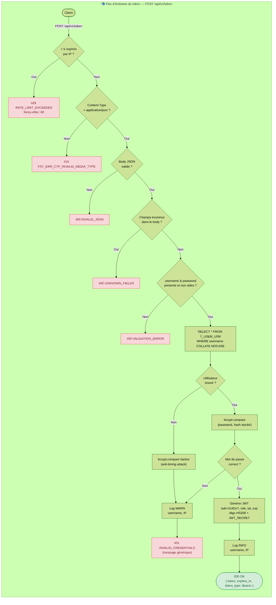
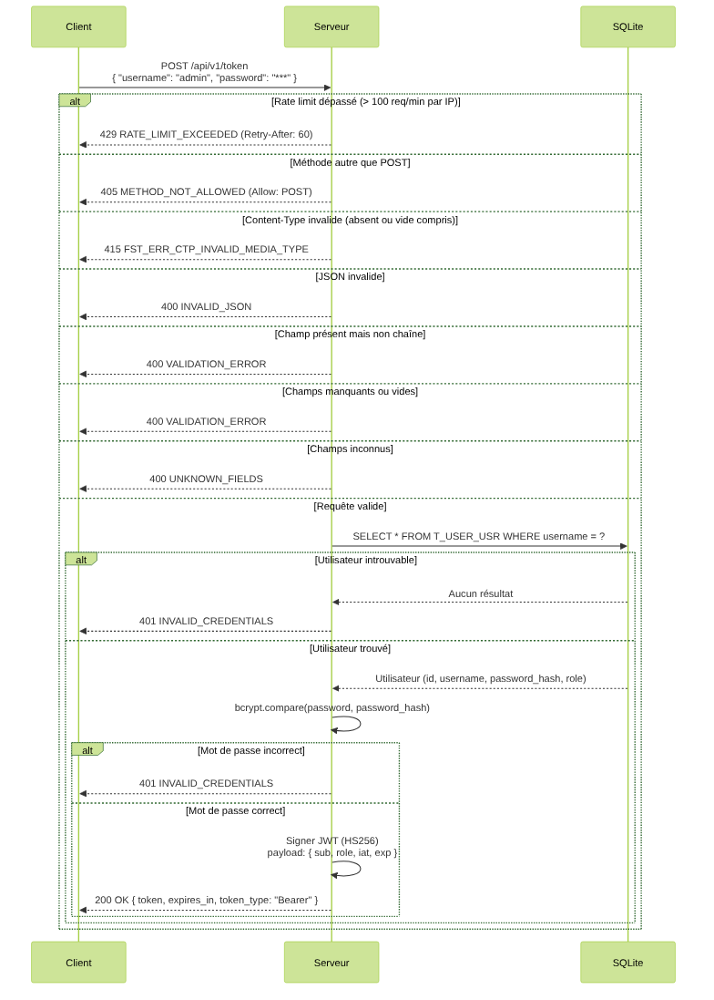

# US-003 — Authentification et émission du token JWT

## 📋 Contexte projet

Voir [VISION.md](../shared/VISION.md) pour la description complète du projet et de ses quatre applications.

---

## 🎯 User Story

> **En tant qu'** utilisateur (administrateur ou buzzer),
> **je veux** m'authentifier auprès du serveur avec mes identifiants (username / password),
> **afin d'** obtenir un token JWT me permettant d'accéder aux ressources protégées de l'API REST et du WebSocket.

---

## ✅ Critères d'acceptance

### Émission du token — `POST /api/v1/token`

| # | Critère | Résultat attendu |
|---|---|---|
| CA-1 | S'authentifier avec un username et un password valides | `200 OK` avec le token JWT, sa durée de validité et son type |
| CA-2 | Le token JWT est signé avec l'algorithme HS256 | Vérifiable avec le secret `JWT_SECRET` |
| CA-3 | Le payload JWT contient les claims `sub` (UUIDv7 utilisateur), `role` ("admin" ou "buzzer"), `iat` et `exp` | Claims conformes à la RFC 7519 |
| CA-4 | La durée de validité du token est de 1 heure par défaut | Configurable via la variable d'environnement `JWT_EXPIRATION` (en secondes) |
| CA-5 | L'endpoint n'est pas protégé par un Bearer token | Accessible sans authentification préalable |
| CA-6 | Le body ne doit contenir que les champs `username` et `password` | Champs inconnus → `400 UNKNOWN_FIELDS` |
| CA-7 | Le `Content-Type` doit être `application/json` | Sinon → `415 FST_ERR_CTP_INVALID_MEDIA_TYPE`. Un `Content-Type` absent ou présent mais vide n'est pas `application/json` : même réponse `415`, avec ou sans body (décision #82, règle transversale de [SECURITE-TRANSVERSALE.md](../shared/SECURITE-TRANSVERSALE.md)). Le type est lu sans tenir compte de la casse, et `application/json; charset=utf-8` est conforme ; un paramètre inconnu est ignoré, mais un `charset` autre qu'`utf-8` répond `415` (décision #89) |

### Gestion des erreurs d'authentification

| # | Critère | Résultat attendu |
|---|---|---|
| CA-8 | Username ou password incorrect | `401 INVALID_CREDENTIALS` — Message générique ne révélant pas lequel est faux |
| CA-9 | Champ `username` manquant, `null` ou vide | `400 VALIDATION_ERROR`, message `Username is required.` (décisions #85 et #86) |
| CA-10 | Champ `password` manquant, `null` ou vide | `400 VALIDATION_ERROR`, message `Password is required.` (décisions #85 et #86) |
| CA-11 | Corps de requête invalide (pas du JSON) | `400 INVALID_JSON` |
| CA-12 | Champs inconnus dans le body | `400 UNKNOWN_FIELDS` |

> **Note du 2026-11-22 (décision #84)** — Quand une requête cumule plusieurs erreurs, une réponse ne porte qu'un code : c'est le premier contrôle en échec du tableau « Ordre des contrôles » ci-dessous qui répond. En particulier, un champ manquant ou vide (CA-9, CA-10) est signalé **avant** un champ inconnu (CA-6, CA-12), et un champ présent mais mal typé avant les deux. Aucun CA n'est ajouté, retiré ni renuméroté.

### Ordre des contrôles

Une requête `POST /api/v1/token` est jugée dans cet ordre ; le premier contrôle en échec fixe la réponse, les suivants ne sont pas évalués (décision #84). Les diagrammes de flux et de séquence suivent le même ordre.

| Ordre | Contrôle | Réponse si échec | CA |
|---|---|---|---|
| 1 | Limite de 100 requêtes par minute et par adresse IP dépassée (toute requête compte, y compris celle qui sera refusée plus loin) | `429 RATE_LIMIT_EXCEEDED`, `Retry-After: 60` | CA-13 |
| 2 | Méthode autre que `POST` | `405 METHOD_NOT_ALLOWED`, `Allow: POST` | CA-16 |
| 2 | `Content-Type` autre que `application/json` (absent et vide compris) | `415 FST_ERR_CTP_INVALID_MEDIA_TYPE` | CA-7 |
| 3 | Corps qui n'est pas du JSON | `400 INVALID_JSON` | CA-11 |
| 4 | Corps JSON qui n'est pas un objet (`null`, tableau, chaîne, nombre, booléen), ou champ `username` ou `password` présent, non `null`, mais qui n'est pas une chaîne | `400 VALIDATION_ERROR` | CA-9, CA-10 |
| 5 | Champ `username` ou `password` manquant, `null` ou vide | `400 VALIDATION_ERROR` | CA-9, CA-10 |
| 6 | Champ inconnu dans le body | `400 UNKNOWN_FIELDS` | CA-6, CA-12 |
| 7 | Username inconnu ou mot de passe incorrect | `401 INVALID_CREDENTIALS` | CA-8 |

Les deux contrôles de l'ordre 2 ne se cumulent jamais : le `405` ne vise que les méthodes autres que `POST`, le `415` que les `POST`. Le corps d'une méthode autre que `POST` n'est jamais lu : un `PUT` ou un `DELETE` au corps JSON invalide ou vide répond `405`, pas `400 INVALID_JSON` (décision #90). Cela vaut aussi pour `HEAD` et `OPTIONS`, avec ou sans corps (décision #93) : `405`, `Allow: POST`, jamais le `400` natif de Fastify.

### Messages de `VALIDATION_ERROR`

Le message de chaque `400 VALIDATION_ERROR` de cette route est **normatif, mot à mot** (décision #85). Une réponse ne nomme qu'**un** champ : c'est celui du premier contrôle en échec de l'ordre des contrôles (rang 4 avant rang 5) ; quand `username` et `password` échouent au **même** rang, c'est `username`, avant `password`, et l'autre n'est pas mentionné (le client corrige en plusieurs allers-retours, comme pour les questions, décision #10). Ainsi `{"password":42}` répond `Password must be a string.` (rang 4) et non `Username is required.` (rang 5).

Une valeur `null` pour `username` ou `password` compte comme **manquante** (rang 5, décision #86, comme le `PUT` d'une question, décision #22) : `{"username":null}` répond `Username is required.`. Le `null` du corps entier reste un corps qui n'est pas un objet (rang 4).

| Ordre | Cas | Message |
|---|---|---|
| 4 | Corps JSON qui n'est pas un objet | `Request body must be a JSON object.` |
| 4 | `username` présent, non `null`, mais qui n'est pas une chaîne | `Username must be a string.` |
| 4 | `password` présent, non `null`, mais qui n'est pas une chaîne | `Password must be a string.` |
| 5 | `username` manquant, `null` ou vide | `Username is required.` |
| 5 | `password` manquant, `null` ou vide | `Password is required.` |

Le corps est le corps standard à trois champs (`status`, `error`, `message`). Entre un champ mal typé et un champ manquant, l'ordre des contrôles prévaut (le type d'abord, décision #84).

### Rate limiting spécifique

| # | Critère | Résultat attendu |
|---|---|---|
| CA-13 | Le endpoint `/token` est limité à 100 requêtes par minute **par adresse IP** | Dépassement → `429 RATE_LIMIT_EXCEEDED` avec header `Retry-After: 60`. Le plafond est la variable `MAX_REQUESTS_PER_MINUTE`, `100` quand elle est absente ; définie mais invalide, le hub refuse de démarrer (CA-21). Le compteur est celui de toute l'API, commun à toutes les routes (annexe CA-RateLimit, décision #96) : les requêtes vers `/token` s'y comptent avec les autres. L'adresse comptée est celle de la connexion (`X-Forwarded-For` ignoré) ; la fenêtre d'une minute est fixe, ouverte à la première requête, et un refus ne la prolonge pas (annexe CA-RateLimit, décision #97) |

### Logging

| # | Critère | Résultat attendu |
|---|---|---|
| CA-14 | Les connexions réussies sont loggées | Une ligne de log au niveau `INFO` porte le `username` et l'adresse IP de la requête ; son message est `Authentication successful` (décision #106) |
| CA-15 | Les connexions échouées sont loggées | Une ligne de log au niveau `WARN` porte le `username` tenté et l'adresse IP de la requête ; son message est `Authentication failed` (décision #106) |

> Ces deux CA n'exigent que le **contenu** (`username`, IP) et le **niveau** de la ligne. Sa **forme** (champs `timestamp`, `level` et `event`, représentation du niveau, horodatage ISO 8601 UTC) n'est pas exigée ici : elle relève d'[US-022](US-022-logging.md#format-json-des-entrées-de-log) (CA-6 à CA-8), qui s'applique à toute entrée de log, y compris celles-ci.

### Méthodes HTTP non supportées

| # | Critère | Résultat attendu |
|---|---|---|
| CA-16 | Méthode HTTP non supportée sur `/api/v1/token` (corps invalide, vide ou valide sans effet : le corps n'est jamais jugé, décision #90 ; `HEAD` et `OPTIONS` compris, décision #93) | `405 METHOD_NOT_ALLOWED` avec header `Allow: POST` |

### Sécurité et transversalité

| # | Critère | Résultat attendu |
|---|---|---|
| CA-17 | Erreur serveur inattendue | `500 INTERNAL_SERVER_ERROR` (aucun détail technique exposé dans la réponse) ; l'erreur technique est journalisée au niveau `ERROR` (voir la note ci-dessous) |

> **Note du 2026-11-23 (décision #91)** — « Aucun détail technique exposé » se définit comme dans `SECURITE-TRANSVERSALE.md` (« Erreurs serveur (500) ») : ni pile, ni message SQL, ni chemin interne. Le corps du `500` est exactement `{ "status": 500, "error": "INTERNAL_SERVER_ERROR", "message": "An unexpected error occurred. Please try again later." }` (décision #34 étendue au token ; `correlation_id` arrive avec US-022), le `message` étant constant. Le `Content-Type` est de type `application/json` (paramètre `charset` non imposé) ; aucun autre en-tête n'est exigé.

> **Note du 2026-11-22 (décision #83)** — Comme CA-14 et CA-15, ce CA n'exige que le **contenu** et le **niveau** du log de l'erreur, pas sa **forme**. Contenu : la ligne de log porte l'erreur technique (son message et sa pile) ; ces détails ne figurent que dans le log serveur, jamais dans la réponse (`SECURITE-TRANSVERSALE.md`, « Erreurs serveur »). Niveau : `ERROR`, comme pour les routes des thèmes et des questions. La forme de la ligne (champs, `event`, horodatage) relève d'[US-022](US-022-logging.md#format-json-des-entrées-de-log), et l'exemple `UNHANDLED_EXCEPTION` de `SECURITE-TRANSVERSALE.md` reste non normatif. Rien d'autre n'est exigé : ni `username`, ni adresse IP, ni nom d'événement.

> **Note du 2026-11-22 (décision #54)** — CA-18 (« Tests unitaires et d'intégration — Couverture de tests ≥ 90% ») est retiré, comme CA-6 d'US-001 le 2026-11-14 et CA-5 d'US-002 le 2026-11-21 : la couverture relève de la méthode TDD, pas d'un critère d'acceptance (le seuil global de 90 % est appliqué par la CI, décision #67 ; la règle « un CA = au moins un test » est inchangée). Le bandeau « Exigence de couverture » est retiré avec lui. La numérotation des autres CA est conservée (CA-19 et CA-20 sont cités par les décisions, par les tests et par les handoffs) : il n'y a donc pas de CA-18.

### Configuration au démarrage

| # | Critère | Résultat attendu |
|---|---|---|
| CA-19 | `JWT_SECRET` est absent, vide ou de moins de 32 caractères | `npm start` refuse de démarrer : le serveur n'écoute sur aucun port, le processus se termine avec le code de sortie `1`, et la console affiche un message qui nomme `JWT_SECRET` et la règle (32 caractères minimum) sans reprendre la valeur. Ex : `Server starting failed: JWT_SECRET is required and must contain at least 32 characters.` |
| CA-20 | `JWT_EXPIRATION` est renseignée mais n'est pas un entier strictement positif écrit en chiffres seulement (`abc`, `3600s`, `1.5`, `1e3`, `0`, `-5`, ` 3600`) | Même refus de démarrer qu'au CA-19, avec un message qui nomme `JWT_EXPIRATION` et la règle (entier strictement positif, en secondes). Absente ou vide, la variable vaut `3600` (CA-4). Aucune borne haute n'est imposée : toute durée entière strictement positive est acceptée (décision #42) |
| CA-21 | `MAX_REQUESTS_PER_MINUTE` est définie mais n'est pas un entier de 1 à 2147483647 écrit en chiffres ASCII seulement, sans signe, sans espace ni tabulation, sans préfixe ni séparateur (règle complète et valeurs refusées : [CA-21 en détail](#ca-21--max_requests_per_minute-invalide)) | `npm start` refuse de démarrer : le serveur n'écoute sur aucun port, le processus se termine avec le code de sortie `1`, et la console affiche, sur la sortie d'erreur, un message qui nomme `MAX_REQUESTS_PER_MINUTE` et la règle sans reprendre la valeur. Absente, la variable vaut `100` (CA-13). Exemple de message, chaîne vide, zéros en tête et ordre des contrôles : [CA-21 en détail](#ca-21--max_requests_per_minute-invalide) |

### CA-21 — `MAX_REQUESTS_PER_MINUTE` invalide

> **Note du 2026-11-24 (décision #94)** — CA-21 est ajouté. Le numéro libre suivant est 21 : CA-18 est retiré (voir la note du 2026-11-22 plus haut) et la numérotation des autres CA n'est pas modifiée.

**Règle.** `MAX_REQUESTS_PER_MINUTE` est définie mais n'est pas un entier de 1 à 2147483647 (le maximum d'un entier signé de 32 bits) écrit en chiffres seulement, c'est-à-dire en chiffres ASCII de `0` à `9`, sans signe, sans espace ni tabulation, sans préfixe ni séparateur. Absente, la variable vaut `100` (CA-13).

**Valeurs refusées** (exemples) :

- la chaîne vide
- `abc`
- `8080abc`
- `1.5`
- `1e3`
- `0`
- `-1`
- `+5`
- ` 5` (espace en tête)
- `5 ` (espace en fin)
- une valeur faite uniquement de blancs (espaces, tabulation)
- `2147483648`

**Refus.** `npm start` refuse de démarrer : le serveur n'écoute sur aucun port, le processus se termine avec le code de sortie `1`, et la console affiche un message qui nomme `MAX_REQUESTS_PER_MINUTE` et la règle (entier de 1 à 2147483647 écrit en chiffres seulement) sans reprendre la valeur. Le message sort sur la sortie d'erreur (décision #50), avec le préfixe que le hub affiche pour tout échec de démarrage.

Ex, non normatif : `Server starting failed: MAX_REQUESTS_PER_MINUTE must be an integer between 1 and 2147483647, written with digits only.` (décision #94).

**Chaîne vide et blancs seuls.** Comme `PORT` ([US-001](US-001-server-startup.md) CA-7) et à la différence de `JWT_EXPIRATION` (CA-20) et de `BCRYPT_COST` ([US-002](US-002-seed-users.md) CA-6), une chaîne vide est refusée et ne vaut pas absente. Une valeur faite uniquement de blancs est refusée par la règle de forme, comme tout blanc de bordure : aucun blanc n'est ignoré, à la différence de `SQLITE_DB_PATH` (US-001 CA-10). Le `MAX_REQUESTS_PER_MINUTE=` vide d'un fichier `.env` est refusé comme toute chaîne vide (décision #52).

**Zéros en tête.** Ils sont acceptés : `0100` vaut 100 ; `00`, qui vaut 0, est refusé (comme `PORT`, décision #46).

**Ordre des contrôles.** Quand plusieurs variables du hub sont invalides ensemble, une seule erreur est rapportée, dans cet ordre : les variables `JWT_*` (CA-19, CA-20), puis `PORT` ([US-001](US-001-server-startup.md), CA-7), puis `MAX_REQUESTS_PER_MINUTE`, puis la base de données (`SQLITE_DB_PATH`, CA-10, puis l'ouverture, CA-9). Le refus vaut dans tous les cas, avec le code de sortie `1` (décision #94).

**Portée.** Cette règle est celle du hub (`npm start`). Le seed n'utilise pas cette variable et l'ignore, comme il ignore `JWT_SECRET` et `JWT_EXPIRATION` (CA-19) : quelle que soit sa valeur (absente, valide, vide, blancs seuls, invalide), elle n'a aucun effet sur lui, qui réussit ou échoue comme si elle n'existait pas ([US-002](US-002-seed-users.md) CA-10, décisions #94 et #95).

> **Note :** Les critères relatifs au seed des comptes utilisateurs (`npm run seed`) ont été extraits vers la **[US-002 — Seed des comptes utilisateurs](US-002-seed-users.md)**.

---

## 🔄 Diagramme de flux



---

## 🔀 Diagramme de séquences



---

## 🔧 Spécifications techniques

Voir les [Conventions techniques](../shared/CONVENTIONS-TECHNIQUES.md) pour la stack complète, les principes d'architecture (KISS, DRY, YAGNI, SOLID) et les conventions de données.

### Spécifications propres à cette US

| Élément | Choix |
|---|---|
| Hachage mot de passe | bcrypt avec sel automatique |
| Token | JWT signé HS256 |

### Schéma de la table

```sql
CREATE TABLE T_USER_USR
(
    USR_ID            TEXT PRIMARY KEY,
    USR_LOGIN         TEXT NOT NULL UNIQUE,  -- UNIQUE sensible à la casse (pas de COLLATE NOCASE)
    USR_HASH_PASSWORD TEXT NOT NULL,  -- hashed with bcrypt
    USR_ROLE          TEXT NOT NULL DEFAULT 'buzzer' CHECK (USR_ROLE IN ('admin', 'buzzer'))
);
```

### Politique de mots de passe

| Règle | Valeur |
|---|---|
| Longueur minimale | 12 caractères |
| Longueur maximale | 72 caractères (limite bcrypt) |
| Complexité | Aucune règle de complexité imposée (conformité OWASP) |
| Hachage | bcrypt avec sel automatique |

### Comptes utilisateurs

Voir [US-002 — Seed des comptes utilisateurs](US-002-seed-users.md) pour la liste complète des 11 comptes (1 admin + 10 buzzers) et leurs variables d'environnement.

### Configuration — Variables d'environnement

| Variable | Description | Obligatoire | Défaut |
|---|---|---|---|
| `JWT_SECRET` | Secret de signature JWT (min 32 caractères) | ✅ Oui | — |
| `JWT_EXPIRATION` | Durée de validité du token en secondes | Non | `3600` |

Tableau d'ensemble de toutes les variables du hub : [Conventions techniques — Variables d'environnement](../shared/CONVENTIONS-TECHNIQUES.md#-variables-denvironnement) (décision #39). `JWT_SECRET` est obligatoire et n'a pas de défaut. Le hub contrôle les deux variables au démarrage, avant d'écouter sur le port, et refuse de démarrer quand elles ne respectent pas leur règle (CA-19, CA-20, décision #40) : jamais au premier token. Il fait de même pour `MAX_REQUESTS_PER_MINUTE`, qui fixe le plafond du CA-13 et n'est pas dans ce tableau (CA-21, décision #94).

### Versioning API

Voir [Conventions techniques — Versioning API](../shared/CONVENTIONS-TECHNIQUES.md#-versioning-api).

---

## 📡 Endpoint

| Méthode | URL | Description | Auth | Code succès |
|---|---|---|---|---|
| `POST` | `/api/v1/token` | Obtenir un token JWT | Aucune | `200 OK` |

### Header `Allow`

| URL | Méthodes autorisées |
|---|---|
| `/api/v1/token` | `POST` |

### Format de la requête

```json
{
  "username": "admin",
  "password": "MonSuperMotDePasse!"
}
```

### Format de la réponse — Succès `200 OK`

```json
{
  "token": "eyJhbGciOiJIUzI1NiIsInR5cCI6IkpXVCJ9...",
  "expires_in": 3600,
  "token_type": "Bearer"
}
```

### Structure du payload JWT

Voir [Annexe — Authentification et autorisation — Payload JWT](../shared/AUTHENTIFICATION.md#-structure-du-payload-jwt) pour la structure complète des claims.

---

## 🔐 Mécanisme d'authentification

> **Source de vérité** — Cette US définit le mécanisme d'authentification. L'[Annexe — Authentification et autorisation](../shared/AUTHENTIFICATION.md) centralise la documentation de référence pour toutes les US qui réutilisent ce mécanisme.

### Flux d'émission du token

```
Client → POST /api/v1/token { username, password }
  → 1. Validation du body (champs requis, pas de champs inconnus)
  → 2. Recherche de l'utilisateur par username, sensible à la casse, sur `USR_LOGIN`
  → 3. Vérification du mot de passe avec bcrypt.compare()
  → 4. Si échec (étape 2 ou 3) → 401 INVALID_CREDENTIALS (message générique)
  → 5. Génération du JWT (sub, role, iat, exp) signé avec HS256
  → 6. Logging de la connexion (succès ou échec)
  → 7. Retour du token + métadonnées
```

---

## 📝 Logging structuré

### Exemples du format d'US-022 (non normatifs)

> Les deux exemples ci-dessous illustrent le format commun des logs défini par [US-022](US-022-logging.md#format-json-des-entrées-de-log) (CA-6 à CA-8). Ils ne sont **pas** une exigence d'US-003 : CA-14 et CA-15 n'exigent que le contenu et le niveau de la ligne. Seul le texte du message des deux lignes est fixé (décision #106) : `Authentication successful` et `Authentication failed`.

**Connexion réussie :**

```json
{
  "timestamp": "2026-03-07T14:30:00.000Z",
  "level": "INFO",
  "event": "LOGIN_SUCCESS",
  "username": "admin",
  "ip": "192.168.1.100"
}
```

**Connexion échouée :**

```json
{
  "timestamp": "2026-03-07T14:30:05.000Z",
  "level": "WARN",
  "event": "LOGIN_FAILURE",
  "username": "admin",
  "ip": "192.168.1.105"
}
```

---

## 🚨 Catalogue des erreurs

### Codes standards
Voir le [Catalogue centralisé des codes d'erreur](error-codes.md#1️⃣-codes-derreur-standards-transversaux)

### Codes spécifiques à cette US

| Code erreur | Code HTTP | Message | Contexte |
|---|---|---|---|
| `INVALID_CREDENTIALS` | `401` | `"Invalid credentials."` | Username ou password incorrect (message générique) |

---

**Format standard des réponses d'erreur** — Voir [Format standard des réponses d'erreur](error-codes.md#-format-standard-des-réponses-derreur)

---

## 🌱 Seed — Initialisation des comptes

Voir [US-002 — Seed des comptes utilisateurs](US-002-seed-users.md) pour le script de seed, les variables d'environnement des mots de passe et le format du fichier `.env`.

---

## 📐 Périmètre

| Inclus | Exclu |
|---|---|
| Endpoint `POST /api/v1/token` (émission JWT) | Refresh token (YAGNI) |
| Table `T_USER_USR` et schéma | Endpoint de création de comptes utilisateurs |
| Hachage bcrypt des mots de passe | Seed des comptes (→ **US-002**) |
| Logs de connexion, succès et échecs (contenu et niveau ; format → **US-022**) | Changement de mot de passe (US dédiée) |
| Rate limiting spécifique 100 req/min par IP (plafond `MAX_REQUESTS_PER_MINUTE`, valeur invalide refusée au démarrage, CA-21) | Déconnexion (gérée côté client) |
| Gestion complète des erreurs | Authentification WebSocket (US dédiée) |
| Middlewares `authenticate` et `authorize` (réutilisables) | CRUD des utilisateurs |
| | Interface Angular de connexion |

---

## 🔍 Points de vigilance

### Sécurité du message d'erreur d'authentification

Le message "Invalid credentials." est volontairement **générique**. Il ne doit jamais révéler si c'est le username qui n'existe pas ou le password qui est incorrect. Cela empêche l'énumération des comptes utilisateurs.

### Temps de réponse constant (timing attack)

Même si le username n'existe pas, le serveur doit effectuer une comparaison bcrypt factice (avec un hash bidon) pour que le **temps de réponse soit identique** que le username existe ou non. Cela prévient les attaques par analyse du temps de réponse (timing attack).

### Limite de bcrypt

bcrypt tronque les mots de passe à **72 bytes**. La politique impose un maximum de 72 caractères (ASCII) pour rester cohérent. Les mots de passe plus longs seraient silencieusement tronqués, ce qui pourrait causer de la confusion.

### Fichier `.env` et sécurité

Le fichier `.env` contient des mots de passe en clair et le secret JWT. Il **ne doit jamais** être versionné dans Git. Le fichier `.gitignore` doit inclure `.env`. Un fichier `.env.example` est versionné comme modèle, commun au seed et au hub (décision #76) : `JWT_SECRET` y figure **sans valeur**, et le hub refuse de démarrer tant qu'il n'est pas renseigné (CA-19) ; `JWT_EXPIRATION` y figure en **ligne commentée** avec son défaut (`# JWT_EXPIRATION=3600`, CA-4 et CA-20 : absente ou vide, elle vaut `3600`) ; les mots de passe du seed y sont des placeholders `<a_changer>`, refusés par le seed (voir [US-002](US-002-seed-users.md), décision #75).

### Rate limiting par IP sur `/token`

Le rate limiting de 100 req/min est **par adresse IP**. Cela permet à plusieurs clients de s'authentifier simultanément (ex : 10 buzzers + 1 admin au démarrage d'une partie) tout en limitant les tentatives de brute force depuis une même IP. Le compteur de cette adresse est commun à toute l'API (annexe CA-RateLimit, décision #96) : ce n'est pas un compteur propre à `/token`.

### Middlewares réutilisables (DRY / SOLID)

Les middlewares `authenticate` et `authorize` définis dans cette US sont documentés dans l'[Annexe — Authentification et autorisation](../shared/AUTHENTIFICATION.md). Ils sont réutilisés par toutes les US avec des routes protégées (US-004 et suivantes).
