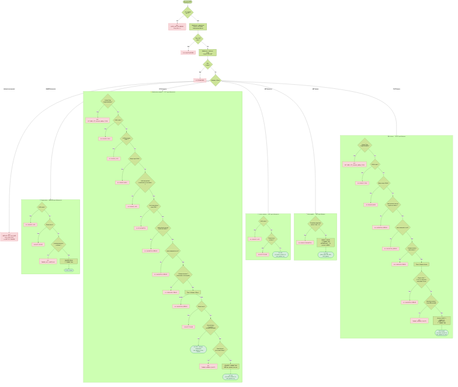
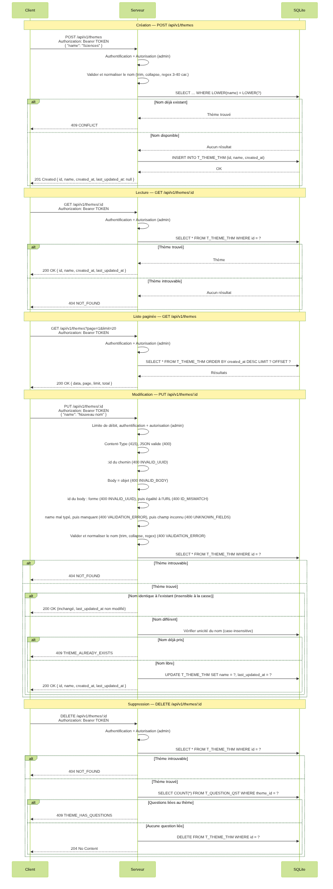

# US-004 — CRUD des thèmes de questions

## 📋 Contexte projet

Voir [VISION.md](../shared/VISION.md) pour la description complète du projet et de ses quatre applications.

---

## 🎯 User Story

> **En tant qu'** administrateur,
> **je veux** pouvoir créer, lire, modifier et supprimer des thèmes de questions,
> **afin de** catégoriser les questions du quiz.

---

## ✅ Critères d'acceptance

> 🧪 **Exigence de couverture** — Voir [Conventions techniques — Couverture des tests](../shared/CONVENTIONS-TECHNIQUES.md#-exigence-de-couverture-des-tests). Chaque CA doit être couvert par au moins un test automatisé. Couverture globale ≥ 90 %.

### Création — `POST /api/v1/themes`

| # | Critère | Résultat attendu |
|---|---|---|
| CA-1 | Créer un thème avec un nom valide | `201 Created` avec le thème créé (id, name, created_at, last_updated_at: null) |
| CA-2 | Le nom est normalisé avant validation (trim + collapse des espaces multiples) | `"  Science   fiction  " → "Science fiction"` |
| CA-3 | Le nom doit respecter la regex `/^[\p{Lu}][\p{L}\p{N} '\-]{1,38}[\p{L}\p{N}]$/u`. Jugé après `name` mal typé, manquant ou `null` et après les champs inconnus (CA-7), avant le `409` (CA-4) ; le message est normatif (décision #101, section « Messages de `VALIDATION_ERROR` du `POST` ») | Entre 3 et 40 caractères, commence par une majuscule, finit par une lettre ou un chiffre |
| CA-4 | L'unicité du nom est insensible à la casse | `"Musique"` existe → `"MUSIQUE"` retourne `409 Conflict` |
| CA-5 | L'ID est un UUIDv7 généré côté Node.js | Format UUID standard (8-4-4-4-12) |
| CA-6 | Les horodatages sont en ISO 8601 UTC, générés côté Node.js | `created_at` rempli, `last_updated_at` à `null` |
| CA-7 | Le body ne doit contenir que le champ `name`. Jugé après `name` mal typé, manquant ou `null`, avant la forme du nom (décision #101, comme #9 et #10) | Champs inconnus → `400 UNKNOWN_FIELDS` |
| CA-8 | Le `Content-Type` doit être `application/json` (absent et vide compris). Jugé après la limite de débit, l'authentification et le rôle, avant le JSON et le corps (décisions #82 et #101) | Sinon → `415 FST_ERR_CTP_INVALID_MEDIA_TYPE` |

### Ordre des contrôles du `POST`

Une requête `POST /api/v1/themes` est jugée dans cet ordre ; le premier contrôle en échec fixe la réponse, les suivants ne sont pas évalués (décision #101). C'est l'ordre du `PUT` (décision #99) sans les rangs propres au chemin : `:id` du chemin, `id` du corps, `404` et nom identique. Les diagrammes de flux et de séquence suivent le même ordre.

| Ordre | Contrôle | Réponse si échec | CA |
|---|---|---|---|
| 1 | Limite de débit (décision #96), puis authentification et rôle (annexe, CA-Bearer et CA-Forbidden) | `429 RATE_LIMIT_EXCEEDED`, `401 UNAUTHORIZED`, `403 FORBIDDEN` | CA-32, CA-33, CA-34 |
| 2 | `Content-Type` autre que `application/json` (absent et vide compris) | `415 FST_ERR_CTP_INVALID_MEDIA_TYPE` | CA-8 |
| 3 | Corps qui n'est pas du JSON | `400` (le code de l'erreur n'est pas décidé ici, voir `DEBTS.md`) | — |
| 4 | Corps JSON qui n'est pas un objet (`null`, tableau, chaîne, nombre, booléen) | `400 INVALID_BODY` (`error-codes.md`) | — |
| 5 | `name` présent, non `null`, mais qui n'est pas une chaîne | `400 VALIDATION_ERROR`, `Theme name must be a string.` | CA-3 |
| 6 | `name` manquant ou `null` | `400 VALIDATION_ERROR`, `Theme name is required.` | CA-3 |
| 7 | Champ inconnu dans le body | `400 UNKNOWN_FIELDS` | CA-7 |
| 8 | Forme du `name` après normalisation (trim, collapse, regex) | `400 VALIDATION_ERROR`, `Theme name must be 3 to 40 characters, start with an uppercase letter, end with a letter or digit, and contain only letters, digits, spaces, apostrophes and hyphens.` | CA-2, CA-3 |
| 9 | Nom déjà pris par un thème existant (insensible à la casse) | `409 THEME_ALREADY_EXISTS` | CA-4 |

Précisions (décision #101) :
- Le rang 1 reprend les décisions existantes : le `429` passe avant l'authentification (#96), l'authentification et le rôle avant tout jugement du corps (#31, #92 ; annexe `SECURITE-TRANSVERSALE.md`). Elles ne sont pas redécidées ici.
- Les rangs 2 et 3 sont ceux de Fastify, avant la route (#82, #84, #11) ; le rang 3 ne se rend que sur une méthode supportée (#92).
- Le rang 4 est le code que `error-codes.md` donne à un JSON valide qui n'est pas un objet (`INVALID_BODY`, message du catalogue : « Request body must be a JSON object. »). L'exception de ce catalogue ne vise que `POST /api/v1/token` (#85, #86).
- Les rangs 5 et 6 ne portent que sur `name`. Un `name` à `null` compte comme manquant (rang 6, comme au `PUT`, #100, et comme #22 pour les questions et #86 pour le token). Les messages sont normatifs (section ci-dessous).
- Le rang 8 juge le nom normalisé (CA-2) ; le `409` du rang 9 compare le nom normalisé.
- Un corps invalide ne révèle pas si un thème de ce nom existe : les rangs 3 à 8 passent avant le `409`.
- Aucun CA n'est ajouté, retiré ni renuméroté.

### Messages de `VALIDATION_ERROR` du `POST`

Le message de chaque `400 VALIDATION_ERROR` du `POST` est **normatif, mot à mot** (décision #101), au corps standard à trois champs (`status`, `error`, `message`), identique à celui du `PUT` pour le même contrôle. Une réponse ne nomme qu'un contrôle : le premier en échec de l'ordre ci-dessus.

| Ordre | Cas | Message |
|---|---|---|
| 5 | `name` présent, non `null`, mais qui n'est pas une chaîne (nombre, booléen, tableau, objet) | `Theme name must be a string.` |
| 6 | `name` manquant ou `null` | `Theme name is required.` |
| 8 | `name` qui, après trim et collapse, ne respecte pas la regex de CA-3 (vide, trop court ou trop long, majuscule initiale absente, fin interdite, caractère interdit) | `Theme name must be 3 to 40 characters, start with an uppercase letter, end with a letter or digit, and contain only letters, digits, spaces, apostrophes and hyphens.` |

### Lecture d'un thème — `GET /api/v1/themes/:id`

| # | Critère | Résultat attendu |
|---|---|---|
| CA-9 | Récupérer un thème par son ID | `200 OK` avec le thème (id, name, created_at, last_updated_at) |
| CA-10 | ID inexistant (UUID bien formé ; seule la forme est contrôlée, pas la version, décision #98) | `404 NOT_FOUND` |
| CA-11 | ID mal formé (pas un UUID valide : forme `8-4-4-4-12` hexadécimale, toute version, décision #98) | `400 INVALID_UUID` |
| CA-12 | Un body éventuel est ignoré silencieusement | Aucune erreur |
| CA-12a | Le `Content-Type` est ignoré sur les requêtes GET | Aucune validation, quelle que soit sa valeur |

### Lecture de la liste — `GET /api/v1/themes`

| # | Critère | Résultat attendu |
|---|---|---|
| CA-13 | Récupérer la liste des thèmes avec pagination | `200 OK` avec objet `{ data, page, limit, total, total_pages }` |
| CA-14 | Tri par date de création descendant (plus récents en premier) | Ordre garanti |
| CA-15 | Paramètres de pagination par défaut : `page=1`, `limit=20` | Appliqués si non fournis |
| CA-16 | Le paramètre `limit` est plafonné à `100` | `limit=200` → `400 INVALID_PAGINATION` |
| CA-17 | Paramètres de pagination invalides (négatifs, zéro, non numériques) | `400 INVALID_PAGINATION` |
| CA-18 | Page au-delà du total | `200 OK` avec `data: []` et métadonnées correctes |
| CA-19 | Aucun thème en base | `200 OK` avec `{ "data": [], "page": 1, "limit": 20, "total": 0, "total_pages": 0 }` |
| CA-19a | Le `Content-Type` est ignoré sur les requêtes GET | Aucune validation, quelle que soit sa valeur |

### Modification — `PUT /api/v1/themes/:id`

| # | Critère | Résultat attendu |
|---|---|---|
| CA-20 | Modifier le nom d'un thème existant | `200 OK` avec le thème mis à jour, `last_updated_at` mis à jour |
| CA-21 | Les mêmes règles de validation et normalisation que le POST s'appliquent (même ordre, sans les rangs propres au chemin, décision #101). La forme du nom (trim, collapse, regex) est jugée avant le `404` (CA-25), même sur un id inconnu ; l'unicité (CA-24) après lui (décision #99). Un `name` absent, `null` ou qui n'est pas une chaîne répond `400 VALIDATION_ERROR`, avant les champs inconnus (CA-27) ; les messages sont normatifs (section « Messages de `VALIDATION_ERROR` du `PUT` », décision #100) | Trim, collapse, regex, unicité |
| CA-22 | Le nom envoyé est identique à l'existant (comparaison insensible à la casse). Jugé après la forme du nom et le `404`, avant le `409` (décision #99) | `200 OK` avec le thème inchangé, `last_updated_at` **non modifié** |
| CA-23 | L'ID peut être présent dans le body ; s'il l'est, il doit correspondre à l'URL. Il est jugé juste après le `:id` du chemin, avant le reste du corps (décision #99, comme #30) : mal formé ou non chaîne (`null`, nombre…), même s'il diffère de l'URL → `400 INVALID_UUID` ; bien formé mais différent → `400 ID_MISMATCH` | Sinon → `400 ID_MISMATCH` |
| CA-24 | Le nom est déjà pris par un autre thème. Jugé après le `404` (CA-25) et après CA-22 (décision #99) | `409 THEME_ALREADY_EXISTS` |
| CA-25 | ID inexistant (UUID bien formé). Jugé après toutes les règles de forme du corps, nom compris : un corps invalide répond `400` même sur un id inconnu (décision #99, comme #23) | `404 NOT_FOUND` |
| CA-25a | `:id` de l'URL mal formé (décision #98). Jugé après le `415` et le JSON invalide, avant les contrôles du corps (décision #99) | `400 INVALID_UUID` |
| CA-26 | Le `Content-Type` doit être `application/json` (jugé avant le `:id` du chemin et le corps, décision #99) | Sinon → `415 FST_ERR_CTP_INVALID_MEDIA_TYPE` |
| CA-27 | Le body ne doit contenir que les champs `name` (et optionnellement `id`). Jugé après le `name` mal typé, manquant ou `null` (décisions #99 et #100, comme #9 et #10) | Champs inconnus → `400 UNKNOWN_FIELDS` |

### Ordre des contrôles du `PUT`

Une requête `PUT /api/v1/themes/:id` est jugée dans cet ordre ; le premier contrôle en échec fixe la réponse, les suivants ne sont pas évalués (décision #99). Les diagrammes de flux et de séquence suivent le même ordre.

| Ordre | Contrôle | Réponse si échec | CA |
|---|---|---|---|
| 1 | Limite de débit (décision #96), puis authentification et rôle (annexe, CA-Bearer et CA-Forbidden) | `429 RATE_LIMIT_EXCEEDED`, `401 UNAUTHORIZED`, `403 FORBIDDEN` | CA-32, CA-33, CA-34 |
| 2 | `Content-Type` autre que `application/json` (absent et vide compris) | `415 FST_ERR_CTP_INVALID_MEDIA_TYPE` | CA-26 |
| 3 | Corps qui n'est pas du JSON | `400` (le code de l'erreur n'est pas décidé ici, voir `DEBTS.md`) | — |
| 4 | `:id` du chemin mal formé | `400 INVALID_UUID` | CA-25a |
| 5 | Corps JSON qui n'est pas un objet (`null`, tableau, chaîne, nombre, booléen) | `400 INVALID_BODY` (`error-codes.md`) | — |
| 6 | `id` du corps présent et mal formé ou non chaîne, puis bien formé mais différent de l'URL | `400 INVALID_UUID`, puis `400 ID_MISMATCH` | CA-23 |
| 7 | `name` présent, non `null`, mais qui n'est pas une chaîne | `400 VALIDATION_ERROR`, `Theme name must be a string.` | CA-21 |
| 8 | `name` manquant ou `null` | `400 VALIDATION_ERROR`, `Theme name is required.` | CA-21 |
| 9 | Champ inconnu dans le body | `400 UNKNOWN_FIELDS` | CA-27 |
| 10 | Forme du `name` après normalisation (trim, collapse, regex) | `400 VALIDATION_ERROR`, `Theme name must be 3 to 40 characters, start with an uppercase letter, end with a letter or digit, and contain only letters, digits, spaces, apostrophes and hyphens.` | CA-21 |
| 11 | Thème inexistant | `404 NOT_FOUND` | CA-25 |
| 12 | Nom identique à l'existant (insensible à la casse) | `200 OK`, thème inchangé, `last_updated_at` non modifié (ce n'est pas un échec : le contrôle 13 n'est pas évalué) | CA-22 |
| 13 | Nom déjà pris par un autre thème | `409 THEME_ALREADY_EXISTS` | CA-24 |

Précisions (décisions #99 et #100) :
- Le rang 1 reprend les décisions existantes : le `429` passe avant l'authentification (#96), l'authentification et le rôle avant tout jugement du corps (#31, #92 ; annexe `SECURITE-TRANSVERSALE.md`). Elles ne sont pas redécidées ici.
- Les rangs 2 et 3 sont ceux de Fastify, avant la route (#82, #84, #11) ; le rang 3 ne se rend que sur une méthode supportée (#92).
- Le rang 5 ne s'applique qu'à un corps qui n'est pas un objet : on ne peut pas lire son `id`. `INVALID_BODY` est le code du catalogue `error-codes.md` pour ce cas (message du catalogue : « Request body must be a JSON object. »).
- Les rangs 7 et 8 ne portent que sur `name` ; `id` est jugé au rang 6. Un `name` à `null` compte comme manquant (rang 8, décision #100, comme #22 pour les questions et #86 pour le token). Le texte des messages de `VALIDATION_ERROR` est normatif (décision #100, section ci-dessous).
- Un corps invalide ne révèle pas si le thème existe : les rangs 4 à 10 passent avant le `404`.
- Un `:id` vide (URL à segment vide) est jugé au rang 4 comme un `:id` mal formé (#93).
- Aucun CA n'est ajouté, retiré ni renuméroté.

### Messages de `VALIDATION_ERROR` du `PUT`

Le message de chaque `400 VALIDATION_ERROR` du `PUT` est **normatif, mot à mot** (décision #100), au corps standard à trois champs (`status`, `error`, `message`). Une réponse ne nomme qu'un contrôle : le premier en échec de l'ordre ci-dessus.

| Ordre | Cas | Message |
|---|---|---|
| 7 | `name` présent, non `null`, mais qui n'est pas une chaîne (nombre, booléen, tableau, objet) | `Theme name must be a string.` |
| 8 | `name` manquant ou `null` | `Theme name is required.` |
| 10 | `name` qui, après trim et collapse, ne respecte pas la regex de CA-3 (vide, trop court ou trop long, majuscule initiale absente, fin interdite, caractère interdit) | `Theme name must be 3 to 40 characters, start with an uppercase letter, end with a letter or digit, and contain only letters, digits, spaces, apostrophes and hyphens.` |

Les messages du `POST` sont les mêmes, rang pour rang (section « Messages de `VALIDATION_ERROR` du `POST` », décision #101).

### Suppression — `DELETE /api/v1/themes/:id`

| # | Critère | Résultat attendu |
|---|---|---|
| CA-28 | Supprimer un thème existant sans questions liées | `204 No Content` sans body |
| CA-29 | ID inexistant | `404 NOT_FOUND` |
| CA-29a | `:id` de l'URL mal formé (décision #98) | `400 INVALID_UUID` |
| CA-30 | Le thème a des questions associées | `409 THEME_HAS_QUESTIONS` |
| CA-31 | Un body éventuel est ignoré silencieusement ; la limite par défaut de Fastify s'applique pourtant (décision #107) | Aucune erreur ; un body de plus de 1 MiB (1 048 576 octets) → `413`, corps d'erreur de Fastify : `{ "statusCode": 413, "code": "FST_ERR_CTP_BODY_TOO_LARGE", "error": "Payload Too Large", "message": "Request body is too large" }` (1 MiB exactement accepté) |
| CA-31a | Le `Content-Type` est ignoré sur les requêtes DELETE | Aucune validation, quelle que soit sa valeur |

### Sécurité et transversalité

Voir [Annexe — Critères de sécurité transversaux](../shared/SECURITE-TRANSVERSALE.md)

Les critères suivants s'appliquent à toutes les routes de cette US :

| # | Critère | Résultat attendu |
|---|---|---|
| CA-32 | Bearer token (voir annexe CA-Bearer) | Token absent/invalide/expiré → `401 UNAUTHORIZED` |
| CA-33 | Rôle administrateur (voir annexe CA-Forbidden) | Rôle insuffisant → `403 FORBIDDEN` |
| CA-34 | Rate limiting (voir annexe CA-RateLimit) | Dépassement → `429 RATE_LIMIT_EXCEEDED` avec header `Retry-After: 60` |
| CA-35 | Méthode HTTP (voir annexe CA-MethodNotAllowed ; corps JSON invalide, vide ou valide sans effet : jugé après le `401` et le `403`, jamais jugé pour le `405`, décision #92 ; URL à segment vide : `:id` vide, jugé comme un `:id` mal formé, décision #93) | `405 METHOD_NOT_ALLOWED` avec header `Allow` adapté |
| CA-36 | Erreur serveur (voir annexe CA-InternalError) | `500 INTERNAL_SERVER_ERROR` sans détails techniques |
| CA-37 | Tests unitaires et d'intégration | Couverture de tests ≥ 90% |

---

## 🔄 Diagramme de flux



---

## 🔀 Diagramme de séquences



---

## 🧪 Cas de tests — requêtes cURL

> **Variables** à définir avant d'exécuter les commandes :
> ```bash
> BASE_URL=http://localhost:3000
> TOKEN=<votre_token_JWT_admin>           # Obtenu via POST /api/v1/token (US-003)
> TOKEN_BUZZER=<token_JWT_buzzer>         # Token avec rôle buzzer (pour CA-33)
> THEME_ID=<uuid_theme_créé>             # Renseigné après CA-1
> ```

### Création — `POST /api/v1/themes`

**CA-1** — Créer un thème avec un nom valide → `201 Created`

```bash
curl -s -w "\n→ HTTP %{http_code}\n" -X POST "$BASE_URL/api/v1/themes" \
  -H "Authorization: Bearer $TOKEN" \
  -H "Content-Type: application/json" \
  -d '{"name": "Musique"}'
```

**CA-2** — Nom normalisé (trim + collapse) → `201 Created` avec nom normalisé

```bash
curl -s -w "\n→ HTTP %{http_code}\n" -X POST "$BASE_URL/api/v1/themes" \
  -H "Authorization: Bearer $TOKEN" \
  -H "Content-Type: application/json" \
  -d '{"name": "  Science   fiction  "}'
# Vérifier que "name" dans la réponse vaut "Science fiction"
```

**CA-3** — Nom ne respectant pas la regex → `400 VALIDATION_ERROR`

```bash
curl -s -w "\n→ HTTP %{http_code}\n" -X POST "$BASE_URL/api/v1/themes" \
  -H "Authorization: Bearer $TOKEN" \
  -H "Content-Type: application/json" \
  -d '{"name": "m"}'
```

**CA-3** — `name` manquant → `400 VALIDATION_ERROR`, `Theme name is required.` (décision #101)

```bash
curl -s -w "\n→ HTTP %{http_code}\n" -X POST "$BASE_URL/api/v1/themes" \
  -H "Authorization: Bearer $TOKEN" \
  -H "Content-Type: application/json" \
  -d '{}'
```

**CA-4** — Doublon de nom (insensible à la casse) → `409 THEME_ALREADY_EXISTS`

```bash
# Prérequis : le thème "Musique" existe déjà (cf. CA-1)
curl -s -w "\n→ HTTP %{http_code}\n" -X POST "$BASE_URL/api/v1/themes" \
  -H "Authorization: Bearer $TOKEN" \
  -H "Content-Type: application/json" \
  -d '{"name": "MUSIQUE"}'
```

**CA-7** — Champ inconnu dans le body → `400 UNKNOWN_FIELDS`

```bash
curl -s -w "\n→ HTTP %{http_code}\n" -X POST "$BASE_URL/api/v1/themes" \
  -H "Authorization: Bearer $TOKEN" \
  -H "Content-Type: application/json" \
  -d '{"name": "Sport", "couleur": "rouge"}'
```

**CA-7** — Champ inconnu et nom de forme invalide → `400 UNKNOWN_FIELDS`, pas `VALIDATION_ERROR` (décision #101)

```bash
curl -s -w "\n→ HTTP %{http_code}\n" -X POST "$BASE_URL/api/v1/themes" \
  -H "Authorization: Bearer $TOKEN" \
  -H "Content-Type: application/json" \
  -d '{"name": "m", "couleur": "rouge"}'
```

**CA-8** — Content-Type incorrect → `415 FST_ERR_CTP_INVALID_MEDIA_TYPE`

```bash
curl -s -w "\n→ HTTP %{http_code}\n" -X POST "$BASE_URL/api/v1/themes" \
  -H "Authorization: Bearer $TOKEN" \
  -H "Content-Type: text/plain" \
  -d '{"name": "Sport"}'
```

### Lecture d'un thème — `GET /api/v1/themes/:id`

**CA-9** — Récupérer un thème par son ID → `200 OK`

```bash
curl -s -w "\n→ HTTP %{http_code}\n" -X GET "$BASE_URL/api/v1/themes/$THEME_ID" \
  -H "Authorization: Bearer $TOKEN"
```

**CA-10** — ID inexistant → `404 NOT_FOUND`

```bash
curl -s -w "\n→ HTTP %{http_code}\n" -X GET "$BASE_URL/api/v1/themes/018e4f5a-8c3b-7d2e-9f1a-4b5c6d7e8f9a" \
  -H "Authorization: Bearer $TOKEN"
```

**CA-11** — ID mal formé → `400 INVALID_UUID`

```bash
curl -s -w "\n→ HTTP %{http_code}\n" -X GET "$BASE_URL/api/v1/themes/not-a-uuid" \
  -H "Authorization: Bearer $TOKEN"
```

**CA-12a** — Content-Type ignoré sur GET ressource → `200 OK` (même avec Content-Type incorrect)

```bash
curl -s -w "\n→ HTTP %{http_code}\n" -X GET "$BASE_URL/api/v1/themes/$THEME_ID" \
  -H "Authorization: Bearer $TOKEN" \
  -H "Content-Type: text/plain"
# Attendu : 200 OK (Content-Type est ignoré sur GET)
```

### Lecture de la liste — `GET /api/v1/themes`

**CA-13** — Lister les thèmes avec pagination → `200 OK`

```bash
curl -s -w "\n→ HTTP %{http_code}\n" -X GET "$BASE_URL/api/v1/themes" \
  -H "Authorization: Bearer $TOKEN"
```

**CA-16** — `limit` > 100 → `400 INVALID_PAGINATION`

```bash
curl -s -w "\n→ HTTP %{http_code}\n" -X GET "$BASE_URL/api/v1/themes?limit=200" \
  -H "Authorization: Bearer $TOKEN"
```

**CA-18** — Page au-delà du total → `200 OK` avec `data: []`

```bash
curl -s -w "\n→ HTTP %{http_code}\n" -X GET "$BASE_URL/api/v1/themes?page=999" \
  -H "Authorization: Bearer $TOKEN"
```

**CA-19a** — Content-Type ignoré sur GET collection → `200 OK` (même avec Content-Type incorrect)

```bash
curl -s -w "\n→ HTTP %{http_code}\n" -X GET "$BASE_URL/api/v1/themes" \
  -H "Authorization: Bearer $TOKEN" \
  -H "Content-Type: text/plain"
# Attendu : 200 OK (Content-Type est ignoré sur GET)
```

### Modification — `PUT /api/v1/themes/:id`

**CA-20** — Modifier le nom d'un thème existant → `200 OK`

```bash
curl -s -w "\n→ HTTP %{http_code}\n" -X PUT "$BASE_URL/api/v1/themes/$THEME_ID" \
  -H "Authorization: Bearer $TOKEN" \
  -H "Content-Type: application/json" \
  -d '{"name": "Musique classique"}'
```

**CA-23** — ID dans le body différent de l'URL → `400 ID_MISMATCH`

```bash
curl -s -w "\n→ HTTP %{http_code}\n" -X PUT "$BASE_URL/api/v1/themes/$THEME_ID" \
  -H "Authorization: Bearer $TOKEN" \
  -H "Content-Type: application/json" \
  -d '{"id": "018e4f5a-8c3b-7d2e-9f1a-4b5c6d7e8f9a", "name": "Musique classique"}'
```

**CA-23** — ID du body mal formé (même s'il diffère de l'URL) → `400 INVALID_UUID` (décision #99)

```bash
curl -s -w "\n→ HTTP %{http_code}\n" -X PUT "$BASE_URL/api/v1/themes/$THEME_ID" \
  -H "Authorization: Bearer $TOKEN" \
  -H "Content-Type: application/json" \
  -d '{"id": "not-a-uuid", "name": "Musique classique"}'
```

**CA-25a** — `:id` mal formé → `400 INVALID_UUID`

```bash
curl -s -w "\n→ HTTP %{http_code}\n" -X PUT "$BASE_URL/api/v1/themes/not-a-uuid" \
  -H "Authorization: Bearer $TOKEN" \
  -H "Content-Type: application/json" \
  -d '{"name": "Musique classique"}'
```

**CA-25** — ID inexistant → `404 NOT_FOUND`

```bash
curl -s -w "\n→ HTTP %{http_code}\n" -X PUT "$BASE_URL/api/v1/themes/018e4f5a-8c3b-7d2e-9f1a-4b5c6d7e8f9a" \
  -H "Authorization: Bearer $TOKEN" \
  -H "Content-Type: application/json" \
  -d '{"name": "Inexistant"}'
```

**CA-25** — Nom de forme invalide sur un ID inexistant → `400 VALIDATION_ERROR`, pas `404` (décision #99)

```bash
curl -s -w "\n→ HTTP %{http_code}\n" -X PUT "$BASE_URL/api/v1/themes/018e4f5a-8c3b-7d2e-9f1a-4b5c6d7e8f9a" \
  -H "Authorization: Bearer $TOKEN" \
  -H "Content-Type: application/json" \
  -d '{"name": "m"}'
```

### Suppression — `DELETE /api/v1/themes/:id`

**CA-28** — Supprimer un thème sans questions liées → `204 No Content`

```bash
curl -s -w "\n→ HTTP %{http_code}\n" -X DELETE "$BASE_URL/api/v1/themes/$THEME_ID" \
  -H "Authorization: Bearer $TOKEN"
```

**CA-29a** — `:id` mal formé → `400 INVALID_UUID`

```bash
curl -s -w "\n→ HTTP %{http_code}\n" -X DELETE "$BASE_URL/api/v1/themes/not-a-uuid" \
  -H "Authorization: Bearer $TOKEN"
```

**CA-29** — ID inexistant → `404 NOT_FOUND`

```bash
curl -s -w "\n→ HTTP %{http_code}\n" -X DELETE "$BASE_URL/api/v1/themes/018e4f5a-8c3b-7d2e-9f1a-4b5c6d7e8f9a" \
  -H "Authorization: Bearer $TOKEN"
```

**CA-30** — Thème avec questions associées → `409 THEME_HAS_QUESTIONS`

```bash
# Prérequis : $THEME_ID référence un thème ayant au moins une question liée
curl -s -w "\n→ HTTP %{http_code}\n" -X DELETE "$BASE_URL/api/v1/themes/$THEME_ID" \
  -H "Authorization: Bearer $TOKEN"
```

**CA-31a** — Content-Type ignoré sur DELETE → `204 No Content` (même avec Content-Type incorrect)

```bash
curl -s -w "\n→ HTTP %{http_code}\n" -X DELETE "$BASE_URL/api/v1/themes/$THEME_ID" \
  -H "Authorization: Bearer $TOKEN" \
  -H "Content-Type: text/plain"
# Attendu : 204 No Content (Content-Type est ignoré sur DELETE)
```

### Sécurité et transversalité

Voir [Annexe — Critères de sécurité transversaux](../shared/SECURITE-TRANSVERSALE.md) pour tous les cas de test de sécurité (CA-Bearer, CA-Forbidden, CA-RateLimit, CA-MethodNotAllowed, CA-InternalError).

**Exemple rapide — CA-32 Token absent** :

```bash
curl -s -w "\n→ HTTP %{http_code}\n" -X GET "$BASE_URL/api/v1/themes"
# Attendu : 401 UNAUTHORIZED
```

**Exemple rapide — CA-33 Rôle insuffisant** :

```bash
curl -s -w "\n→ HTTP %{http_code}\n" -X GET "$BASE_URL/api/v1/themes" \
  -H "Authorization: Bearer $TOKEN_BUZZER"
# Attendu : 403 FORBIDDEN
```

Consulter l'annexe pour les autres cas (rate limiting, méthode non supportée, erreur serveur).

---

## 🔧 Spécifications techniques

Voir les [Conventions techniques](../shared/CONVENTIONS-TECHNIQUES.md) pour la stack complète, les principes d'architecture (KISS, DRY, YAGNI, SOLID) et les conventions de données.

### Schéma de la table

```sql
CREATE TABLE T_THEME_THM
(
    THM_ID              TEXT PRIMARY KEY,
    THM_NAME            TEXT NOT NULL UNIQUE COLLATE NOCASE,
    THM_CREATED_AT      TEXT NOT NULL,
    THM_LAST_UPDATED_AT TEXT DEFAULT NULL
);
```

### Validation du nom — Pipeline de normalisation

```
Entrée brute
  → 1. Trim (suppression espaces début/fin)
  → 2. Collapse (espaces multiples → espace simple)
  → 3. Vérification non vide
  → 4. Validation regex : /^[\p{Lu}][\p{L}\p{N} '\-]{1,38}[\p{L}\p{N}]$/u
  → 5. Vérification unicité (COLLATE NOCASE) en base
```

### Versioning API

Voir [Conventions techniques — Versioning API](../shared/CONVENTIONS-TECHNIQUES.md#-versioning-api).

### Format JSON — Convention snake_case

**Thème unitaire :**

```json
{
  "id": "018e4f5a-8c3b-7d2e-9f1a-4b5c6d7e8f9a",
  "name": "Musique",
  "created_at": "2026-03-07T14:30:00.000Z",
  "last_updated_at": null
}
```

**Liste paginée :**

```json
{
  "data": [
    {
      "id": "018e4f5b-1a2b-7c3d-8e4f-5a6b7c8d9e0f",
      "name": "Sport",
      "created_at": "2026-03-07T14:30:00.000Z",
      "last_updated_at": "2026-03-07T15:45:00.000Z"
    },
    {
      "id": "018e4f5a-8c3b-7d2e-9f1a-4b5c6d7e8f9a",
      "name": "Musique",
      "created_at": "2026-03-06T10:00:00.000Z",
      "last_updated_at": null
    }
  ],
  "page": 1,
  "limit": 20,
  "total": 2,
  "total_pages": 1
}
```

---

## 📡 Endpoints

| Méthode | URL | Description | Auth | Code succès |
|---|---|---|---|---|
| `POST` | `/api/v1/themes` | Créer un thème | Bearer (admin) | `201 Created` |
| `GET` | `/api/v1/themes` | Lister les thèmes (paginé) | Bearer (admin) | `200 OK` |
| `GET` | `/api/v1/themes/:id` | Récupérer un thème | Bearer (admin) | `200 OK` |
| `PUT` | `/api/v1/themes/:id` | Modifier un thème | Bearer (admin) | `200 OK` |
| `DELETE` | `/api/v1/themes/:id` | Supprimer un thème | Bearer (admin) | `204 No Content` |

### Headers `Allow` par ressource

| URL | Méthodes autorisées |
|---|---|
| `/api/v1/themes` | `GET, POST` |
| `/api/v1/themes/:id` | `GET, PUT, DELETE` |

---

## 🔐 Authentification et autorisation

Voir l'[Annexe — Authentification et autorisation](../shared/AUTHENTIFICATION.md) pour le mécanisme JWT, la structure du payload et l'architecture middleware.

Les middlewares `authenticate` et `authorize('admin')` définis en [US-003](US-003-authentication-token.md) sont réutilisés sur toutes les routes de cette US.

**Application sur les routes :**

```javascript
router.post('/api/v1/themes',       authenticate, authorize('admin'), createTheme);
router.get('/api/v1/themes',        authenticate, authorize('admin'), listThemes);
router.get('/api/v1/themes/:id',    authenticate, authorize('admin'), getTheme);
router.put('/api/v1/themes/:id',    authenticate, authorize('admin'), updateTheme);
router.delete('/api/v1/themes/:id', authenticate, authorize('admin'), deleteTheme);
```

---

## 🚨 Catalogue des erreurs

### Codes standards
Voir le [Catalogue centralisé des codes d'erreur](error-codes.md#1️⃣-codes-derreur-standards-transversaux)

### Codes spécifiques à cette US

| Code erreur | Code HTTP | Message | Contexte |
|---|---|---|---|
| `THEME_ALREADY_EXISTS` | `409` | `"A theme with this name already exists."` | Doublon de nom (comparaison insensible à la casse) |
| `THEME_HAS_QUESTIONS` | `409` | `"Cannot delete this theme: questions are still associated with it."` | Suppression d'un thème avec questions liées |

---

**Format standard des réponses d'erreur** — Voir [Format standard des réponses d'erreur](error-codes.md#-format-standard-des-réponses-derreur)

---

## 📐 Périmètre

| Inclus | Exclu |
|---|---|
| CRUD complet des thèmes (POST, GET, GET list, PUT, DELETE) | CRUD des questions (US dédiée) |
| Validation et normalisation du nom | Interface Angular de gestion des thèmes |
| Pagination de la liste | Recherche / filtrage des thèmes |
| Gestion complète des erreurs | Émission du token / endpoint `/token` (US-003) |
| Middlewares `authenticate` et `authorize` (réutilisables) | Déploiement / CI-CD |
| Rate limiting (100 req/min) | |
| Tests unitaires et d'intégration (couverture ≥ 90%) | |

---

## 🔍 Points de vigilance

### Unicité insensible à la casse

L'unicité du nom repose sur `COLLATE NOCASE` dans SQLite. La contrainte `UNIQUE` de la table gère nativement ce cas. Côté application, la vérification d'unicité avant insertion/mise à jour doit également être insensible à la casse pour fournir un message d'erreur clair (`409`) plutôt qu'une erreur SQL brute.

### PUT sans changement réel

Lorsqu'un `PUT` est effectué avec un nom identique à l'existant (comparaison insensible à la casse), la colonne `THM_LAST_UPDATED_AT` ne doit **pas** être mise à jour. Le serveur doit comparer le nom normalisé entrant avec le nom stocké (insensible à la casse) avant de décider de mettre à jour l'horodatage.

### Suppression avec dépendances

Avant toute suppression, le serveur doit vérifier l'existence de questions liées au thème via la clé étrangère. Si des questions existent, la suppression est refusée avec une erreur `409 THEME_HAS_QUESTIONS`. Cette vérification applicative est préférable à un `ON DELETE RESTRICT` seul, car elle permet de retourner un message d'erreur métier explicite.

### Cohérence UUIDv7 et horodatage

L'UUIDv7 et le `created_at` étant tous deux générés côté Node.js, il est recommandé de les générer au même instant pour garantir la cohérence entre le timestamp intégré dans l'UUIDv7 et la valeur de `created_at`.

### Sécurité des erreurs 500

Voir [Annexe — Critères de sécurité transversaux — CA-InternalError](../shared/SECURITE-TRANSVERSALE.md#erreurs-serveur-500-internal_server_error). Les erreurs internes ne doivent jamais exposer de détails techniques dans la réponse API.
